<p align="center"></p>

We stand on the shoulders of giants.

# nextsycl

- **A curated Ollama for everything a local machine needs** - chat, images, video, music and speech
- **Use our kernels for your engine** - every engine is a library, its kernels SYCL you can build on
- **No CUDA, no PyTorch, no Vulkan** - SYCL only, optimized for Intel Arc
- **No Python**
- **No Node**
- **Every useful model, optimized**
- **Silo architecture** - only do what is best for model X ([CONTRIBUTING.md](CONTRIBUTING.md) rule 6)
- **Test driven** - nothing is committed until it beats the base, with the same results
- **A single API control plane** - the front door on :8000
- **A Docker-style CLI** - `nextsycl <kind> start | stop | ps | logs | ...`
- **A porting methodology** - [CONTRIBUTING.md](CONTRIBUTING.md) and [the SYCL porting skill](skills/sycl-porting/SKILL.md)

## RUN

`nextsycl models pull <id>`, then pick it in the front door (:8000) or the chat front end - or `nextsycl llm start <id>`
for a chat model. Measured speeds, decode / prompt reading:

**On two 32 GB cards** (measured on an Arc Pro B70 + B65, 61 GB of host RAM, an NVMe; two B70s at least as fast):

| id | model | speed |
|---|---|---|
| `deepseek-r1-iq1s` | **DeepSeek-R1 671B** (unsloth UD-IQ1_S, 131 GiB) - the experts that do not fit VRAM in pinned RAM (multiplied on the CPU) and on the NVMe | ~8 tok/s / ~135 tok/s, 32K context |
| `glm-5.3-flash-uncensored-256k` | **GLM-5.3-Flash** uncensored IQ2 | ~18 tok/s / 450-1,100 tok/s, to 256K |
| `deepseek-v4-flash-iq2m`, `-256k` | **DeepSeek-V4-Flash 284B** (unsloth UD-IQ2_M, 84.7 GiB) - the experts beyond VRAM in pinned RAM; llama.cpp pages it from the disk (no result in 100 minutes) | ~27 tok/s with its MTP draft block (26 at 3.7K, 17 at 256K) / 635-1,000 tok/s (943 at 256K), 128K or 256K context (1M tested: 287 tok/s prompt, 12 tok/s decode) |
| `deepseek-v4.1-flash-vq` | **DeepSeek-V4.1-Flash-1017** (Baekpica's VQ GGUF, 105.8 GiB: experts as vector codes, ~1.6 bits a weight; DeepSeek's Engram tables, 203 GB, read a row at a time from the NVMe) - the experts beyond VRAM in pinned RAM and the file | ~21-22 tok/s / 320-600 tok/s (585 at 318K, 520 over a 1M prompt: 33 min), 128K or 1M context; a needle found at 35K, 318K and 1,025,205 tokens |
| `nemotron-3.5-super-q2kxl` | **Nemotron 3.5 Super 120B-A12B** (unsloth UD-Q2_K_XL; hybrid Mamba-2 / latent MoE / attention; text only) | ~40 tok/s with its MTP drafts (30 without) / ~790-1,140 tok/s, 32K (128K tested: 868 / 34) |
| `nemotron-3.5-super-iq1m` | **Nemotron 3.5 Super** UD-IQ1_M (the same; or on the B70 alone, experts in pinned RAM: ~21 tok/s / ~350 tok/s at 2K) | ~46 tok/s with MTP (32 without) / ~880-1,470 tok/s, 32K (128K tested: 1,120 / 38); `-b70`: the B70 alone, ~21 / 450-560 |

**On one 32 GB card** (measured on an Arc Pro B70):

| id | model | speed |
|---|---|---|
| `qwen3.8-flash-next-iq2_xs` | **Qwen3.8-Flash-Next** 125B MoE IQ2_XS (MTP drafts) | ~80 tok/s / ~1,200 tok/s, 128K |
| `qwen3.8-flash-next-coder-iq1_m` | **Qwen3.8-Flash-Next Coder** IQ1_M | ~77 tok/s / ~1,400 tok/s, 128K |
| `qwen3.8-27b-q4` | **Qwen3.8-27B** dense UD-Q4_K_M (MTP drafts) | 43-49 tok/s, 128K |
| `muse-glimmer-30b-q8` | **Muse Glimmer 30B** abliterated, dense Q8_0 with its DFlash drafter (reasons on its to=self channel) | 30-77 tok/s by text (18.7 without drafts) / ~1,350 tok/s (1,215 at 35K), 128K |
| `muse-glimmer-30b-q8-b70`, `-b65` | the same on one card alone, without the drafter (it does not fit beside the model) | 18.7 (B70) / 16.9 (B65) tok/s, 128K |
| `muse-glimmer-30b-q4`, `-q6` | **Muse Glimmer 30B** Q4_K_M / Q6_K on the B70 alone, with its drafter | 43 / 35 tok/s (25.4 / 20 without drafts) / ~1,400 tok/s, 128K |
| `qwen-image-2.1-q8` | **Qwen-Image 2.1** text to image, edits | 1024x1024, 40 steps: 23.8 s (16.5 s int8) |
| `hunyuanimage-2.1-distilled-q8` | **HunyuanImage 2.1** text to image at 2K (quoted text spelled by its glyph encoder) | 2048x2048, 8 steps: 10.4 s; 1024x1024: 3.9 s |
| `unlimited-ocr-q8`, `-q4` | **Unlimited-OCR** pictures and PDFs to Markdown (tables as HTML, boxes), its own page | a page: ~2-3 s to see, ~130 tok/s written |
| `paddleocr-vl-1.6` | **PaddleOCR-VL** text, tables (HTML), formulas (LaTeX), charts, seals, spotting; the same OCR page | a page: ~1.2 s to see, ~200-250 tok/s written |
| `olmocr-2-7b-q8` | **olmOCR-2** whole pages to Markdown (tables HTML, equations LaTeX), turned pages righted; the same OCR page | a page: ~3 s to see, ~55 tok/s written |
| `unirig` | **UniRig** a skeleton and skin weights for any mesh (`model3d.rig`) | a 7.6K-vertex humanoid: 6-8 s |
| `rignet` | **RigNet** a skeleton and skin weights for a character mesh (`model3d.rig`); its own crate, **GPLv3** as RigNet's code | a 7.6K-vertex humanoid: 2.3 s |
| `animateanymesh` | **AnimateAnyMesh** a mesh set in motion by a sentence, as morph targets (`model3d.rig` with a prompt) | a 7.6K-vertex humanoid, 16 frames: 3.7 s |
| `minimax-h3` | **MiniMax H3** video with sound | 896x672, 4.5 s: ~90 s |
| `minimax-music3-int8` | **MiniMax Music 3** songs | a minute of song: 89 s |
| `qwen3-tts-custom` | **Qwen3-TTS** speech | a minute of speech: 10.7 s (8.2 s int8); a sentence: 0.64 s |

A Rust runtime for language, image, video and audio models on Intel Arc GPUs, with SYCL kernels. Each kind of model has
a contract its server and command line drive, and each model architecture its own engine behind it, tuned end to end -
a library another program can use without the server (`docs/architecture.md`). New models are welcome:
`CONTRIBUTING.md` walks through a port, from each kind's template engine. The language models today: **GLM-5.3-Flash**
(`glm5-next`, `llm/glm5next`): 45 layers of KDA and MLA attention with a DSA lightning indexer, 288 experts, and
hyper-connections. The experts that do not fit the cards live in pinned host memory, and the GPU reads them over PCIe.
It runs on one card or splits the layers over several. And **Qwen3.8-Flash-Next** (`qwen4exp`, `llm/qwen4exp`): Gated
DeltaNet and QSA attention, hyper-connections, a hashed per-layer embedding and 512 experts, on the Strata SYCL port's
kernels - every weight in VRAM over the two cards or on one with its cold experts in pinned host memory, the MTP draft
layer, the window and the drafter as SYCL graphs; verify passes and batches bit-exact, greedy output with drafts equal
to output without. Every model's speed at each context length: [Speed by model](#speed-by-model). **Qwen-Image 2.1**
(`image/qwenimage21`): text to image, its Qwen3-VL text encoder, 7B DiT and RGBA VAE all in SYCL, checked stage by
stage against the reference on the same quantized files; 1024x1024 in 40 steps takes 23.8 s on the B70 (16.5 s with
int8 weights), 37.5 s on the B65. **MiniMax H3** (`video/h3`): text, pictures, a voice and other clips to video with
sound - H3's SYCL engine moved in whole (its jobs, daemon, studio and tools as `nextsycl video ...`), with its own
speed: a 896x672, 4.5 s clip in 87-95 s on the B70 (8 s a step), H3's 98 s. **MiniMax Music 3**
(`audio/minimaxmusic3`): songs from lyrics and a description, up to six minutes of 44.1 kHz stereo - its 8B semantic
language model, RVQ depth decoder, 2.4B flow-matching transformer and Flow-VAE decoder in SYCL, checked stage by stage
against MiniMax's diffusers code on the same files; a minute of song in 89 s on the B70 with the language model in int8
(118 s in half). **Qwen3-TTS** (`audio/qwen3tts`): speech in ten languages - nine built-in voices styled by an
instruction, voices made up from a description, voices cloned from a recording - its talker, code predictor, 12 Hz
codec (decoder and encoder) and speaker encoder in SYCL, checked against qwen-tts' own code; a minute of speech in 10.7
s on the B70 (8.2 s in int8). **Breeze TTS 2** (`audio/breezetts2`): English and Chinese speech - voices designed from
a description, cloned from a recording and its transcript, or cloned and directed by an instruction, vocal events
inline ("(laugh)", "[笑]") - its T5Gemma2 text encoder, Qwen3 backbone and depth decoder from CrispASR's GGUF on the
music engine's kernels and its own, the 12 Hz codec shared with Qwen3-TTS; checked against upstream's code; 1.8-2.2x
real time on the B70. **VibeVoice** (`audio/vibevoice`): long-form speech of up to four speakers, each voice cloned
from a recording without its transcript - its Qwen2.5-1.5B language model, diffusion head and streaming σ-VAE decoder
and semantic encoder in SYCL from gguf-org's GGUF, checked stage by stage against transformers' implementation; 10.6x
real time on the B70. **Voxtral TTS** (`audio/voxtraltts`): Mistral's Voxtral 4B TTS - nine languages in 20 preset
voices - its Ministral 3B backbone, flow-matching acoustic transformer and Voxtral codec decoder from CrispASR's GGUF,
checked against vllm-omni's code; 2.3x real time on the B70 (the open weights have no audio encoder: no cloning from a
recording; saved voices enrolled by fitting their codes on the GPU, experimental).

A skill for porting to SYCL on Arc - the safety rules, migration traps, parity method, profiling and what made
things fast, learned on these ports: [skills/sycl-porting/SKILL.md](skills/sycl-porting/SKILL.md).

## Supported models

What `nextsycl models search` lists and `nextsycl models pull <id>` installs: a model card each
(`model-cards/<kind>/<id>.yml` - direct links, sizes and SHA-256, the registry settings, the prompt guide; read at
run time, not built in: [model-cards/README.md](model-cards/README.md)). **Checked**: compared stage by stage with a reference run on the same files. **Served**:
running in daily use here, with its speed measured. **Listed**: in the catalog, not yet run on this machine.

**Language** (`nextsycl llm`)

| id | model | engine | size | status |
|---|---|---|---|---|
| `glm-5.3-flash-uncensored`, `-128k`, `-256k` | GLM-5.3-Flash uncensored IQ2, 64K / 128K / 256K context | `glm5next` | 89.9 GiB | checked (llama.cpp), served on both cards |
| `deepseek-r1-iq1s` | DeepSeek-R1 671B UD-IQ1_S, 32K: experts in VRAM, pinned RAM (on the CPU) and the NVMe | `deepseek2` | 130.6 GiB | checked (llama.cpp), served on both cards |
| `deepseek-v4-flash-iq2m`, `-256k` | DeepSeek-V4-Flash 284B UD-IQ2_M, 128K / 256K + 32K: sliding window + compressed attention (CSA / HCA, the lightning indexer), mHC, experts in VRAM and pinned RAM, MTP drafts (the original checkpoint's draft block, converted after the pull); a needle found at 35K, 140K, 261K and 1,071,766 tokens | `deepseek4` | 88.3 GiB | checked (llama.cpp), served on both cards |
| `deepseek-v4.1-flash-vq` | DeepSeek-V4.1-Flash-1017 VQ, 128K: V4's attention with the indexer at ratio 1/2 and shared compressed keys, mHC, the Engram (n-gram rows from DeepSeek's tables on disk), VQ experts on XMX from their indices, the DSpark draft towers (off by default), pictures through the vision sidecar (ViT + aligner); docs/ports/deepseek41.md | `deepseek41` | 105.8 GiB + 203 GB Engram | checked (CPU reference), served on both cards |
| `nemotron-3.5-super-q2kxl` | NVIDIA Nemotron 3.5 Super 120B-A12B UD-Q2_K_XL (40 Mamba-2, 40 latent-MoE, 8 attention layers; 512 experts, 22 a token), 32K, MTP drafts; text only (the vision tower not yet) | `nemotronh` | 56 GiB | checked (llama.cpp), served |
| `nemotron-3.5-super-iq1m` | the same, UD-IQ1_M, on both GPUs | `nemotronh` | 43 GiB | checked (llama.cpp), served |
| `nemotron-3.5-super-iq1m-b70` | the same on the B70 alone, the experts that do not fit in pinned host memory (the B65 left free) | `nemotronh` | 43 GiB | served |
| `qwen3.8-flash-next-iq2_xs` | Qwen3.8-Flash-Next IQ2_XS | `qwen4exp` | 63.4 GiB | served (verify passes and batches exact) |
| `qwen3.8-flash-next-iq2_xs-uncensored` | the same with the refusal projection (a control vector) | `qwen4exp` | 63.4 GiB | served |
| `qwen3.8-flash-next-coder-iq1_m`, `-uncensored` | Qwen3.8-Flash-Next Coder IQ1_M | `qwen4exp` | 54.4 GiB | served |
| `swift-1.5-iq2_xs` | Swift 1.5 IQ2_XS (short thinking) | `qwen4exp` | 63.5 GiB | served |
| `qwen3.8-27b-q8` | Qwen3.8-27B Q8_0 (dense: gated DeltaNet + gated full attention), 32K, MTP drafts | `qwen35` | 28.4 GiB | checked (llama.cpp), served (verify passes exact) |
| `qwen3.8-27b-q4` | Qwen3.8-27B UD-Q4_K_M, 128K + 32K, MTP drafts | `qwen35` | 16.6 GiB | checked (llama.cpp), served (verify passes exact) |
| `qwen3.8-27b-q3` | Qwen3.8-27B UD-Q3_K_XL, 128K + 32K, MTP drafts | `qwen35` | 13.5 GiB | served |
| `qwen3.8-27b-q8-256k` | Qwen3.8-27B Q8_0 on both GPUs, 256K + 32K, MTP drafts | `qwen35` | 28.4 GiB | served (verify passes exact) |
| `qwen3.8-27b-q4-256k` | Qwen3.8-27B UD-Q4_K_M on both GPUs, 256K + 32K, MTP drafts | `qwen35` | 16.6 GiB | served (verify passes exact) |
| `muse-glimmer-30b-q8` | Muse Glimmer 30B Abliterated Q8_0 (dense gated attention: 39 sliding-window layers of 2,048, 13 full; post norms, soft-capped logits), 128K + 32K; its DFlash drafter (15 drafts a step, verify rows exact: the same text as without); its reasoning as `reasoning_content` | `muse-glimmer` | 29.1 GiB | checked (llama.cpp, 6K tokens), served |
| `muse-glimmer-30b-q8-b70`, `muse-glimmer-30b-q8-b65` | the same on the B70 or the B65 alone, no drafter (the engine drops it anyway when it does not fit), 128K + 32K | `muse-glimmer` | 26.2 GiB | served |
| `muse-glimmer-30b-q4`, `muse-glimmer-30b-q6` | Muse Glimmer 30B Q4_K_M / Q6_K on the B70 alone with its DFlash drafter (the silo's K-quant products on XMX, verify exact), 128K + 32K | `muse-glimmer` | 15.8 / 21.3 GiB + 1.5 | checked (spec-check 0), served |

**3D** (`nextsycl model3d`: a mesh from a picture)

| id | model | engine | size | status |
|---|---|---|---|---|
| `hunyuan3d-2mini-turbo` | Hunyuan3D-2mini-turbo: the 0.6B Flux-style DiT, DINOv2-giant, the FlashVDM turbo decoder; shape only | `hunyuan3d` | 3.9 GiB | checked |
| `hunyuan3d-2.1` | Hunyuan3D 2.1: the 3.0B MoE DiT (shape) and the paint model (PBR textures) | `hunyuan3d` | 15.0 GiB | checked |

**Image** (`nextsycl image`; sizes with the text encoder, VAE and tokenizer)

| id | model | engine | size | status |
|---|---|---|---|---|
| `qwen-image-2.1-q8` | Qwen-Image 2.1 Q8_0: text to image (RGBA), edits and compositions of up to 8 pictures | `qwenimage21` | 16.4 GiB | checked, served |
| `hunyuanimage-2.1-distilled-q8` | HunyuanImage 2.1 Distilled (MeanFlow, guidance embedded): text to image at 2K, 8 steps | `hunyuanimage-2.1` | 24.4 GiB (25.3 GiB at 2048x2048) | checked |
| `hunyuanimage-2.1-q8` | HunyuanImage 2.1 Q8_0: 50 steps, a negative prompt's guidance (APG) | `hunyuanimage-2.1` | 24.3 GiB | checked |
| `unlimited-ocr-q8`, `unlimited-ocr-q4` | Unlimited-OCR (Baidu, the DeepSeek-OCR architecture): pages to Markdown, tables as HTML, boxes with `<|grounding|>`; long pages in fixed memory | `unlimited-ocr` | 6.5 GiB (decoder in half) | checked (PIL, deepencoder.py, llama.cpp), served |
| `paddleocr-vl-1.6` | PaddleOCR-VL 1.6 (PaddlePaddle): SigLIP NaViT at the page's size + ERNIE-4.5 0.3B; text, tables, formulas, charts, seals, spotting | `paddleocr-vl` | ~3 GiB (vision float32, decoder half) | checked (transformers), served |
| `olmocr-2-7b-q8` | olmOCR-2-7B-1025 (Ai2, a Qwen2.5-VL-7B fine-tune): pages to Markdown in reading order | `olmocr2` | ~11 GiB (decoder Q8_0, vision float32) | checked (llama.cpp), served |
| `qwen-image-2.1-turbo-q8` | Qwen-Image 2.1 Turbo (Viggle v0.3 merged): 6 steps | `qwenimage21` | 16.5 GiB | checked |
| `qwen-image-2.1-q6k`, `-uncensored-q8` | Qwen-Image 2.1 Q6_K; the uncensored model in Q8_0 | `qwenimage21` | 14.8 / 16.4 GiB | listed |
| `qwen-image-2.1-q4km`, `-uncensored-q4km` | Q4_K_M | `qwenimage21` | 13.6 GiB | listed (needs Q5_K in the dequant) |

**LoRAs** for Qwen-Image 2.1 (`--lora NAME[:SCALE]`, merged at load)

| id | what | status |
|---|---|---|
| `qwen-image-2.1-uncensored-lora` | the uncensored change, rank 16 | checked |
| `qwen-image-2.1-turbo-lora` | Viggle's 6-step turbo, rank 128 (brings its sigmas) | served |
| `qwen-image-2.1-pruna-8step-lora` | Pruna's 8-step distill (brings its sigmas) | checked |
| `qwen-image-2.1-pruna-5step-lora` | Pruna's 5-step distill | listed |

**Video** (`nextsycl video`: text, pictures, a voice and other clips to video with sound)

| id | model | engine | size | status |
|---|---|---|---|---|
| `minimax-h3` | MiniMax H3: the 50-block FL2VA DiT in int8 ConvRot (the fastest), the Qwen3-VL 32B text encoder (Q4_K_M), video and audio VAEs, the latent upscaler | `video/h3` | 42.6 GiB | served (H3's own engine moved in; checked against it) |
| `minimax-h3-q6k`, `-q4km` | the denoiser as a Q6_K / Q4_K_M GGUF: less of the card, longer clips | `video/h3` | 38.5 / 33.6 GiB | served by H3 |
| `minimax-h3-q8` | the denoiser as a Q8_0 GGUF (a reference form) | `video/h3` | 43.0 GiB | listed |
| `minimax-h3-realism-lora`, `-ref2v-turbo-lora`, `-lms-lora` | LoRAs: realism (people), ref2v in 4 steps, LMS | | | listed (realism: served by H3) |

**Audio** (`nextsycl audio`: songs from lyrics and a description; speech from text)

| id | model | engine | size | status |
|---|---|---|---|---|
| `minimax-music3` | MiniMax Music 3: the 8B semantic language model and RVQ depth decoder (half on the card), the 2.4B flow transformer, the Flow-VAE decoder; up to 6 minutes, 44.1 kHz stereo | `minimaxmusic3` | 26.6 GiB | checked, served |
| `minimax-music3-int8` | the same files, the language model and depth decoder in int8 at load: half the VRAM, 1.7x the frames a second | `minimaxmusic3` | 26.6 GiB | checked, served |
| `qwen3-tts-custom` | Qwen3-TTS 12 Hz 1.7B CustomVoice: nine built-in voices, styled by an instruction; 10 languages, 24 kHz | `qwen3tts` | 4.5 GiB | checked, served |
| `qwen3-tts-design` | Qwen3-TTS VoiceDesign: a voice made up from a description | `qwen3tts` | 4.5 GiB | checked, served |
| `qwen3-tts-base` | Qwen3-TTS Base: a voice cloned from a recording (its x-vector; with its transcript, in context) | `qwen3tts` | 4.5 GiB | checked, served |
| `voxcpm2` | VoxCPM2 2B: speech in 30 languages at 48 kHz - plain, designed from a description, cloned (with a transcript: continued); MiniCPM4 language models, a local flow-matching DiT, AudioVAE V2 | `voxcpm2` | 4.6 GiB | checked, served |
| `voxcpm2-int8` | the same files, the language models in int8 at load | `voxcpm2` | 4.6 GiB | checked, served |
| `breeze-tts-2` | Breeze TTS 2 (~3B, Q8_0 GGUF): English and Chinese at 24 kHz - voices designed, cloned (recording + transcript) or directed (a clone + an instruction), vocal events; weights and outputs non-commercial (BreezeBlue license) | `breezetts2` | 3.4 GB + codec | checked |
| `vibevoice-1.5b` | VibeVoice-1.5B (Q8_0 GGUF): long-form speech of up to four speakers in English and Chinese at 24 kHz, each voice cloned from a recording (no transcript); MIT, with Microsoft's responsible-use terms | `vibevoice` | 3.9 GiB | checked |
| `breeze-tts-2-q4` | the same model from the Q4_K GGUF (a 2.2 GB download; the same memory on the card; the 4-bit text encoder is 1e-1 from upstream - a word can slip) | `breezetts2` | 2.2 GB + codec | checked |
| `s2-pro` | Fish Audio S2 Pro (~4.6B Dual-AR, Q8_0 GGUF with its codec): ~80 languages at 44.1 kHz - voices cloned (recording + transcript), free-form inline tags (`[whisper]`, `[laughing]` ...; `instructions` become one), several speakers in one text; no voice design; weights and outputs non-commercial (Fish Audio Research License) | `s2pro` | 5.6 GB | checked |
| `voxtral-4b-tts` | Voxtral 4B TTS 2603 (Mistral, Q8_0 GGUF): nine languages at 24 kHz in 20 preset voices; no cloning from a recording, design or instructions (the open weights have no audio encoder); saved voices enrolled for it (experimental); weights, voices and outputs non-commercial (CC BY-NC 4.0) | `voxtraltts` | 4.3 GB | checked |

**3D** (`nextsycl model3d`: rigging and animation of a mesh; the result keeps the input mesh, its UVs and textures)

| id | model | engine | size | status |
|---|---|---|---|---|
| `animateanymesh` | AnimateAnyMesh: a mesh set in motion by a sentence - DyMeshVAE (neighbour attention over the mesh's edges), a rectified-flow MMDiT on SD 1.5's CLIP-L; 16 frames as glTF morph targets (Apache-2.0) | `animateanymesh` | 0.9 GiB | checked |
| `unirig` | UniRig: a skeleton (an OPT-350m-shaped decoder over a Michelangelo shape encoding, 15 sampled beams) and skin weights (Point Transformer V3, bone attention, a voxel geodesic prior) for any mesh (MIT) | `unirig` | 5.4 GiB | checked |
| `rignet` | RigNet: a skeleton (GMEdgeNet joints, RootNet, BoneNet's tree) and skin weights (SkinNet over volumetric geodesics) for a character mesh; **GPLv3**, its own crate | `rignet` | 0.2 GiB | checked |
**3D** (`nextsycl model3d`: a picture to a textured mesh, GLB)

| id | model | engine | size | status |
|---|---|---|---|---|
| `trellis2` | TRELLIS.2 4B Q8_0: DINOv3, four 1.3B flows (structure, shape 512 + 1024, texture 1024), the sparse decoders; the 1024 cascade, PBR textures; BiRefNet cuts opaque pictures out | `trellis2` | 8.8 GiB (9.1 GiB peak on the card) | checked |
| `trellis2-512` | the same, the 512 path only (the 512 shape and texture flows) | `trellis2` | 7.4 GiB (2.9 GiB peak) | checked |
| `pixal3d` | Pixal3D Q8_0: TRELLIS.2 with pixel-aligned DINOv3 features (manual field of view; NAF not ported) | `pixal3d` | 8.9 GiB (4.5 GiB peak) | checked |

## What it does

- **Two cards:** the layers split over the GPUs (each with a SYCL context of its own), the experts in an exclusive
  VRAM / pinned-RAM store.
- **MTP speculative decoding:** the model's own draft block drafts a token, a pass verifies it with the next.
  Verify passes are bit-identical to one-token decode (2 to 5 rows, short and long context: `nextsycl spec-check
  --rows`), so greedy output with MTP equals greedy output without it. At a temperature the draft is sampled from
  the draft block's own distribution and kept with min(1, p/q) (speculative sampling): what is committed is
  distributed exactly as plain sampling, and more drafts are accepted when the model is unsure (61.6% -> 65.0% over
  three prompts at 0.7 / 1.0). Qwen3.8-Flash-Next draws a sampled request's tokens on the GPU (Philox(seed,
  position), the top 64 tokens before top-p) and draws each draft from the draft layer with the uniform of the row
  that will verify it (Strata's coupled draft sampling): 69-70% of drafts accepted at 0.7 / 1.0 instead of 60-64%,
  the text exactly the draws, and the same `seed` the same text. Prompt-lookup drafts (`NS_NGRAM`) are there too, exact, off: on this MoE a longer
  verify pass costs nearly its rows (each brings its own experts).
- **MTP on the dense Qwen3.8-27B too:** its MTP file's draft block proposes 3 tokens a step (chained on its own
  output), one pass verifies them, the DeltaNet states roll back from the pass's snapshots - decode about doubles
  (26 -> 43-49 tok/s on the 4-bit file, 18.5 -> 42 on Q8_0), the same tokens as without (`spec-check`: 0 difference).
- **Kernels tuned per model, in silos:** the shared kernels (`kernels/ns`, Strata's, the diffusion ones) stay as the
  engines on them were tuned; a model's faster versions live in its silo (`kernels/<kind>/<arch>/silo/`, its own
  library `dist/silo/libnextsycl-<arch>.so`), which its engine opens at load and uses for what they cover - the
  shared kernels for the rest, or for everything with `NS_SILO=0` (CONTRIBUTING.md rule 6).
- **Long context, to 256K:** the DSA indexer past 2,048 tokens (each row attends to its top 512 pools of 4 tokens and
  its own unfinished pool), checked against llama.cpp; a context per session (`--ctx 262144,32768` / `NS_CTX`: one
  long session and a short one; default two of 64K). A 253K-token prompt reads in 249 s (~1,020 tok/s) and decodes at
  ~15 tok/s at that depth; a follow-up on it restores its checkpoint in seconds. The model is trained to 1M tokens
  (no RoPE in its MLA); a passphrase is found at 10 / 50 / 90% of 32K-249K documents (`bench --needle`, 9 of 9). The
  latent cache in q8 (544 bytes a token and layer; `NS_KV=f16` for fp16's 1,024 - the same needle result, benchy
  the same or a little faster with q8: `docs/benchy/v1-2026-10-07-q8.md`). Plan and measurements: `docs/256k-context.md`.
- **A prompt path on the XMX units:** prompts are read in chunks of 6,144 tokens, with the dense matrices and MLA's
  attention in fp16 through oneMKL's half GEMMs, and the experts that live in host memory copied on a second queue
  while the previous ones compute. The experts with few tokens skip the fp16 copy: their 2-bit weights are decoded
  straight into the matrix units - gate | up in ESIMD (`xmx::dpas`, a work-group sharing each block's decode through
  local memory; up to 256 tokens on a B70, 128 on a B65), down in `joint_matrix` (up to 128); larger experts are
  expanded to fp16 and multiplied by oneMKL. A prompt over a chunk runs the two GPUs as a pipeline.
- **A prompt cache:** checkpoints of the whole conversation state in host memory, at the end of a prompt's first
  turn, at the start of its last user turn, and at its end; those pushed out of memory go to disk
  (`NS_CACHE_DIR`, default `~/.cache/nextsycl/prompts`, `NS_CACHE_DISK_GIB` 32), and a stop writes the rest there -
  a 256K prompt's checkpoint is ~3.5 GiB, mounted again in seconds instead of re-reading the prompt for minutes.
  The files outlive the server (another context size of the same model and cache form takes them); one unused for
  `NS_CACHE_TTL_HOURS` (24) is removed, and past the size budget the least recently used go first.
- **An OpenAI-compatible server** with streaming and the thinking split out, run as a service: `nextsycl llm start`,
  `stop`, `status`, `ps`, `cache`, `chat`, `logs`, over a control socket.
- **Tool calls (Qwen3.8-Flash-Next):** OpenAI's `tools` go into the model's own template (its `<tools>` list and
  `<tool_call><function=..><parameter=..>` format); the answer's calls come back as `tool_calls`, each argument typed
  by the tool's schema, with `finish_reason: "tool_calls"`, streamed or not; `tool` messages and earlier calls are
  written back in the template's form. The text before a call streams as it comes. GLM-5.3 takes no tools yet.
- **Energy and logprobs in every answer:** `usage.energy_wh` (and `energy_wh` on `/api/chat`'s last line) - the watt-hours
  both cards drew for the request; `logprobs: true` (+ `top_logprobs`, up to 20) returns each answer token's
  log-probability and the likeliest alternatives, as OpenAI's `choices[0].logprobs.content`, streamed or not.
- **Several requests at once:** up to `NS_PARALLEL` (2) conversations decode together - one pass carries a token of
  each, the weights read once for all of them, each row exactly as its own pass would be (`nextsycl batch-check`);
  a single request decodes alone, with the draft block. More wait in order.
  A long prompt is read in one pass that stops at a chunk's end when another request arrives; then in groups of
  chunks with the others' decode steps between them (a chat sent during a 253K prompt's read is answered in ~10 s,
  at ~18 tok/s).
- **LogProbChain** (`logprob_chain: true`, experimental): each answer token's logprob also chained through the attention
  to the turn's own earlier tokens - an answer that only repeats its thinking counts only as sure as the thinking was
  (below).
- **A record of each request:** `nextsycl llm inspect <id>` prints one as JSON (settings, timings, previews of the prompt
  and the answer); the server keeps the last `NS_KEEP_REQUESTS` (100).
- **`POST /api/chat` for web pages:** the same chat as JSON lines (`{"thinking": ...}`, `{"content": ...}`, then a
  `{"done": true, ...}` line with the timings), with CORS for loopback pages and the origins in `NS_CORS`.

## Quick start

New to it, on an Arc Pro B70? [B70_Startup_guide.md](B70_Startup_guide.md) goes from a fresh clone to chat,
pictures, speech, songs and video, with what each step takes.

```sh
./build.sh                          # the kernel libraries and the program, in a container with oneAPI (podman)
echo "NS_MODELS=$HOME/models" > nextsycl.conf
dist/nextsycl models add glm ~/models/GLM-5.3-Flash-IQ2.gguf --gpu all   # register a model (or models pull <id> from the catalog)
dist/nextsycl llm start glm         # load it; the OpenAI API on 127.0.0.1:8085
dist/nextsycl llm status            # live: the GPUs, the request running, the prompt cache
dist/nextsycl llm inspect 4         # one request as JSON (settings, timings, previews; NS_KEEP_REQUESTS are kept)
dist/nextsycl llm chat "Hello"
dist/nextsycl llm stop
```

`dist/nextsycl help` lists every command and setting.

What the commands show during and after a chat (GLM-5.3-Flash IQ2 on an Arc Pro B65 and an Arc Pro B70, the B70
last):

```
$ nextsycl llm status
glm-5.3-flash-uncensored - up 1m44s, context 65536, MTP on, 2 request(s) served

GPU  CARD                      VRAM USED      FREE   LAYERS EXPERTS VRAM/HOST   TEMP   VRAM   POWER
1    Arc Pro B65        30.1GiB / 31.9GiB    1.8GiB     0-21      3784 / 2080    36C    38C     77W
0    Arc Pro B70        30.1GiB / 31.9GiB    1.8GiB    22-44      3633 / 3496    42C    40C    105W
                                                                       the GPUs draw 183 W

request #2 (socket): generating, prompt 23 tokens, 0 reused (none), 166 / 400 generated at 20.5 tok/s, 9s, 1565 J so far
prompt cache: (busy)

$ nextsycl llm ps
ID     VIA     STATE        PROMPT           REUSED    READ  GENERATED   TOK/S    ENERGY  AVG W FINISH       AGO
#2     socket  done             23           0 none    0.8s        169    20.2    1613 J    175 stop         34s
#1     socket  done             20           0 none    1.1s        195    19.5    1903 J    171 stop       2m08s

$ nextsycl llm inspect 2
{
  "answer": {
    "chars": 873,
    "preview": "The sky appears blue because of a phenomenon called Rayleigh scattering. Sunlight is made up of all the colors of the visible spectrum, and as it passes through Earth's atmosphere, it collides with molecules of nitrogen and oxygen—particles much smaller than the wavelengths of visible light. Shorter..."
  },
  "api": "/v1/chat/completions",
  "avg_watts": 174.8,
  "checkpoints_saved": 0,
  "drafts": [75, 94],
  "ended": 1791318178,
  "energy_j": 1613.1,
  "finish": "stop",
  "generate_seconds": 8.385545438,
  "generated": 169,
  "id": 2,
  "last_user": "Explain in a paragraph why the sky is blue.",
  "max_tokens": 400,
  "messages": 1,
  "model": "glm-5.3-flash-uncensored",
  "prompt_chars": 43,
  "prompt_tokens": 23,
  "read_seconds": 0.843844816,
  "reused": 0,
  "settings": {"effort": "low", "max_tokens": 400, "stream": true, "temperature": 1.0, "top_p": 0.95},
  "source": "none",
  "started": 1791318169,
  "state": "done",
  "thinking": {"chars": 0, "preview": ""},
  "tok_s": 20.153727774720338,
  "via": "socket"
}
```

TEMP and VRAM are the cards' package and memory temperatures, POWER each card's draw over the last second, and
ENERGY what both cards drew while the request ran (idle power included) - from the xe driver's sensors. `drafts` is
MTP's accepted / proposed drafts; `reused` the prompt tokens the prompt cache or the live session already held.
Every API answer carries the same energy as `usage.energy_wh` (here 0.448 Wh).

## Models

The models a machine serves are entries in one registry (`NS_REGISTRY`, a JSON file; default
`~/.config/nextsycl/models.json`). An entry has the GGUF file (its first shard), the GPUs, the session contexts, the
engine settings (`NS_QW_MTP`, `NS_QW_CVEC` and the like), whether it is offered, and what a client may send it
(tools, background tasks). Its id is the model id clients see and the name the server answers under;
`nextsycl llm start <id>` runs it.

```sh
nextsycl models list [--json]
nextsycl models add <id> <file.gguf> [--title T] [--gpu 0[,1] | all] [--ctx N[,M...]] [--set NAME=VALUE]...
                    [--no-tools] [--no-tasks] [--disabled]
nextsycl models search [TEXT] [--kind llm|image|video|audio|lora]   # the catalog of supported models
nextsycl models pull <id>... [--dir DIR] [--from DIR]... [--verify] [--again]   # download (resumable), SHA-256, register
nextsycl models remove <id> [--files]        # --files deletes the GGUF shards too
nextsycl models enable <id> | disable <id>
nextsycl llm start <id>
nextsycl llm serve <id>                      # the same in the foreground, its log here
```

```
$ nextsycl models list
ID                                           STATE        SIZE  GPUS     CONTEXT          TITLE
glm-5.3-flash-uncensored                     enabled     89.9G  all      65536            GLM-5.3-Flash uncensored IQ2 · 64K context (both GPUs)
glm-5.3-flash-uncensored-256k                enabled     89.9G  all      262144,32768     GLM-5.3-Flash uncensored IQ2 · 256K context + a 32K chat (both GPUs)
qwen3.8-flash-next-coder-iq1_m               enabled     54.4G  0        131072,32768     Qwen3.8-Flash-Next Coder IQ1_M (coding; the B70, 128K + 32K)
qwen3.8-flash-next-iq2_xs-uncensored         enabled     63.4G  0        131072,32768     Qwen3.8-Flash-Next IQ2_XS uncensored (refusal projection; the B70, 128K + 32K)
swift-1.5-iq2_xs                             enabled     63.5G  0        131072,32768     Swift 1.5 IQ2_XS (short thinking; the B70, 128K + 32K)
```

A model switcher in front of the server (one model serves at a time) can read the registry for its list: an entry
added or disabled shows at once. With `NS_STUDIO_MODES` set to a mode file (one mode a model, its start command
`nextsycl llm start <id>`), every registry change rewrites that file's nextsycl entries (`"managed_by": "nextsycl"`) and
leaves the others alone. `nextsycl llm start <id>` mounts the entry's files at the same paths in the container, so an
entry can point anywhere on the machine.

### Drives: where the files are, and moving them

The front door's **Drives** panel (and `system.drives`, `nextsycl drives`) lists every drive a registered model's files
sit on, plus the models folders set (`NS_MODELS`, `NS_MODEL_DIRS`): each filesystem once, with its device and PCIe
link (sysfs), mount, size, free space, the models' bytes on it, and its read speed once measured. **measure**
(`system.drive.measure`, `nextsycl drives measure <drive>`) reads up to 4 GiB of the drive's largest model files with
O_DIRECT - past the page cache, nothing written - with 4 reads of 16 MiB in flight, and keeps the result with its date
in `serve.json`; it is refused while a model loads from that drive or a move uses it.

Each model row shows where its files are and a **→ drive** button for every other drive; `system.move {model,
drive}` and `nextsycl models move <id> --to <drive | mount>` do the same (the command hands the move to the front door
when it is up, else runs it itself; Ctrl-C or `--cancel` stops it). A move:

1. is refused while the model is loaded, loading or held by the video daemon (stop or disable it first), while
   another move runs (one at a time: `moving.json` beside the registry), while any process has one of its files open
   or mapped, or when the drive lacks the room: the bytes to write plus 1% of the drive (at least 4 GiB) kept free;
2. copies each file - its file and the shards beside it, its files by role, settings that are paths (a folder with
   what is in it) - reading past the page cache and dropping the written pages as it goes (a model's worth of cache
   would push out what the loaded models use), then reads the copy back with O_DIRECT: the same size and SHA-256 or
   the copy is removed and the move fails. A second name of the same file (a hard link) is linked again there;
3. repoints the registry entry in one write (its `file`, `files` and path settings; `path:scale` and lists kept), so the
   next start mounts the new paths;
4. removes the old files - except those another registered model still names (those stay, and that model with them:
   the panel's result lists what was kept and why) - and the folders that emptied.

A cancel or a failure before step 3 removes what the move wrote; the registry stays as it was. Meanwhile nothing
loads the model: the front door's enable and load refuse, a job waits for the move as it waits for room, and
`nextsycl <kind> start` refuses.

**Where files go.** A drive's models folder is a folder set on it (`NS_MODELS`, `NS_MODEL_DIRS`), else
`<mount>/nextsycl-models`. A file below a models folder keeps its path below it (`~/models/olmocr2/x.gguf` ->
`/var/mnt/2TBSSD/nextsycl-models/olmocr2/x.gguf`, and a move back lands where it was); a file anywhere else keeps its
layout below its model's folder - the nearest folder its files share, under its own name
(`/var/mnt/2TBSSD/minimaxmusic3/models/minimax-music3/vocoder/...` -> `~/models/minimax-music3/vocoder/...`). A file
already at the target with the same bytes (a move that did not finish, or another model's copy) is used, not copied;
one with other bytes stops the move.

**Streaming models.** A model whose card says `streams: true` reads weights from its files while it serves
(deepseek-r1-iq1s and V4-Flash read experts from the file tier, the Qwen3.8-Flash-Next family its PLE rows every
window): its drive's speed is its speed, so the page asks before moving one to a slower drive (measured, else by
link), and the command wants `--yes`. Load-once models lose only load seconds on a slower drive.

```
$ nextsycl drives
DRIVE       DEVICE                     LINK          MOUNT                  SIZE     FREE    MODELS  READ
nvme0n1p3   SKHynix_HFS001TEJ9X162N    PCIe 4.0 x4   /var/home              951G      27G      596G  7.2 GB/s (2026-10-17)
            37 models: glm-5.3-flash-uncensored ... deepseek-r1-iq1s ... breeze-tts-2
nvme1n1     PCIe SSD                   PCIe 3.0 x4   /var/mnt/2TBSSD       1877G     344G      287G  1.7 GB/s (2026-10-17)
            20 models: qwen3.8-flash-next-coder-iq1_m ... qwen3.8-27b-q4-256k breeze-tts-2
```

(hardac1: the P41 measures 7.2 GB/s with 4 reads in flight - a single `dd` reads 6.3 -, the DRAM-less Phison 1.7.)

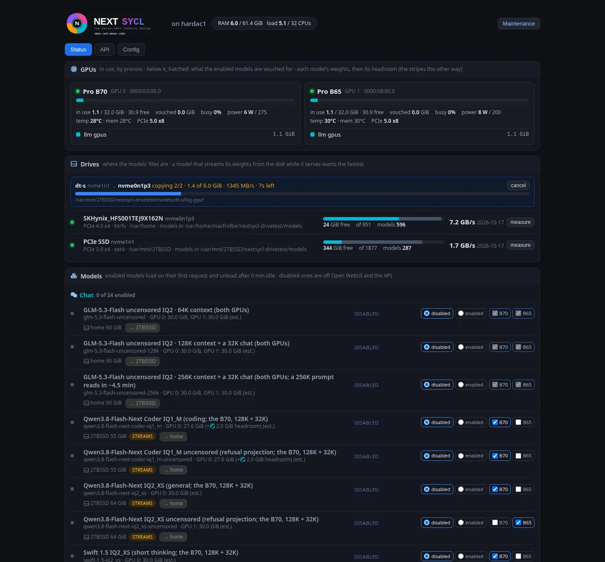

## Host services

Three small services sit beside the model servers, all in the program (no Python on the serving path):

```sh
nextsycl serve [--port 8000] [--host 0.0.0.0] [--serve-host 0.0.0.0] [--idle-minutes 10]
nextsycl switch [--port 8001] [--upstream 127.0.0.1:8085] [--studio http://127.0.0.1:8090/rpc/llm.mode] [--alias OLD=NEW]...
                [--images 127.0.0.1:8086]
nextsycl gpustat [--out /run/gpustat.json] [--interval 3] [--pci ADDR] [--once]     # as root
```

- **`serve`** (:8000, `docs/host/nextsycl-serve.service.example`): the front door.
  - **The page**: every GPU's memory by process, and below it, hatched, what the enabled models are vouched for (as
    seen while they ran, else an estimate from their files; chat models and video engines count once a card - one
    runs at a time - and an overbooked card is flagged: whichever loads first holds it). Every registered model by
    kind: enable it on its GPU(s), start it now (the button spins until it answers), stop it, disable it, its page.
  - **Model pages** through the door: an image, audio or 3D model's own page is `/open/<id>/` (the model starts if it
    is not up; every request under it, the page's API calls too, is passed to its server as `/<rest>`). Those servers
    check no token, so run the door with `--serve-host 127.0.0.1` (the example unit does): they listen on this
    machine only and another machine reaches them here. The video studio and the chat page are sent to by redirect.
  - **Enabled** models load on their first request - an API call, their page, Open WebUI through the switcher - and
    unload after `NS_IDLE_MINUTES` (10) without one (the image and music servers exit, `--idle-exit`; the switcher
    sets the chat mode to none; the video daemon's workers let their card go), staying enabled. A load waits for its
    card to have the model's memory free plus 1.5 GiB (past the card the xe driver spills into host memory); idle
    work holding it is stopped for it at once (picture and sound servers without a request, the video worker while
    the studio has nothing to make, a chat model answering nothing that no `X-Keep-Up-S` keeps - never a render or a
    request), and it answers
    503 `no_room` when the room does not come free (a job waits up to 30 minutes first, saying what for; a chat
    load, like the others, 90 s). **Disabled**: unloaded, gone from Open WebUI's list and from the API.
    The registry's `enabled` and `gpus` are the state (`nextsycl models enable|disable` agree); the enabled video
    models are the video daemon's engines (serve starts, restarts and stops it).
  - **The API**, behind `Authorization: Bearer <token>` (`NS_API_TOKEN`, else one made and kept in `serve.json`
    beside the registry; the page's API tab shows it): `POST /rpc/<kind>.<method>` - H3's rules: POST only, fixed
    routes, every variable in the JSON body, no path variables or query strings, `{"ok": true, "result": ...}` /
    `{"ok": false, "error": {"code", "message", "retryable", "status", "method", "field"}}` - **the body says
    everything**: branch on `error.code`, retry when `retryable`, `field` names the request key at fault, `status` is
    the code's number by convention. **Every /rpc answer is HTTP 200, errors too** (401, an unknown method, a body
    too large to read), so another transport can carry the same envelope; only the OpenAI routes and the files use
    HTTP statuses. An unreadable request (not POST, a query string, not a JSON object, over 256 MiB) is
    wrapped the same way (`invalid_request`, `request_too_large`); the studio's codes are kept for video (`busy`,
    `not_running` ...) and a failed job's `error` is the same object. `no_room` (503: the model's cards are held by
    other models now) is retryable; `conflict` (409: disabled, none enabled) is not - for `system` (state, busy, version, files.stat, files.delete, models, enable, disable, load, unload),
    `llm` (chat, models), `image` (generate, edit, status, jobs, cancel, queue.*, upload, canvases.list, info, progress,
    history), `audio` (generate, speak, status, jobs, cancel, queue.*, upload, voices.*, info, progress, history), `video` (the studio's: generate, status, wait, cancel {label}, queue.* - move and remove by label,
    generate's priority - jobs.*, timeline, upload ...), each kind with
    `describePromptGuideMD {model}`; and the OpenAI-compatible `/v1/models`, `/v1/chat/completions`,
    `/v1/images/generations|edits`, `/v1/audio/speech` and the files they link (and `/v1/video/files/<clip>`, `/v1/video/thumbs/<clip>.webp`). `GET /openapi.yml` describes the
    kinds that have an enabled model (enabling one adds its methods): every body key with its limits and names (the
    video engines as the daemon lists them), each answer's shape (glue/serve/src/home/spec.rs), each method's errors,
    and the video label convention ("Series NN/MM: text"); the API tab lists them with a curl each. The document
    needs no token and carries none (the page's copy fills it in).
    Pictures, songs and speech run as **jobs** (glue/serve/src/home/jobs.rs, kept in jobs.json beside serve.json):
    a label, `<kind>.status {label}`, `<kind>.cancel {label}` (the servers stop that request only, between steps),
    `wait: false` to answer at once; the call can drop and the job goes on, and a restart runs unfinished ones again.
    `reentrant_id` on every generate (video's too) makes a submit idempotent. A kind makes as many jobs at once as
    it has servers; the rest wait in a queue as video's (`priority`, `held`, `project`, `batch`, `queue: false`;
    `<kind>.queue.list|move|pause|resume`), and `stage` / `waiting_for` say what a job waits for. `system.busy` says where work runs
    (slots: two image and audio servers, the video daemon's cards) and each card's share; `system.version` lists the
    features by name; `system.files.stat|delete` give a file's bytes and SHA-256 or remove it (a clip with every
    file of it). video.generate also takes `frames` (exactly 17k + 5), a `chain` object (context_frames, sound,
    still, color_reanchor) and answers frames, seconds and the keys it `ignored` (negative_prompt: H3 runs at cfg 1).
    **API changes, 2026-10-15** (each also in `system.version`'s features):
    - Job requests are **checked when submitted** (glue/serve/src/home/precheck.rs): steps a few-step model does not
      run, size, sampler, cfg without a negative prompt, pictures that do not decode or pass 40 MP, a speech voice or
      language the model does not have (read from its config, loaded or not), a `continue_from` that is not here - a
      400 at once even with `wait: false`, not a failed job later.
    - `image.info` answers `steps` (`locked`, `allowed`: turbo runs only 6) and the limits (8 pictures, 40 MP each,
      256 MiB a request) without the model loaded.
    - `image.edit` `strength` (0.05-1): the denoise starts from the first picture noised that far (ComfyUI's denoise:
      the last steps of a round(steps / strength) run; a few-step model starts at strength itself). `reference:
      false` makes it a plain img2img (the pictures do not condition the model); `image.generate` takes `image` (an
      init picture) with `strength` for the same.
    - `audio.speak` `continue_from` (a speech file made here): its last sentences (up to 15 s, cut at a pause) are
      the in-context reference after the voice's sample, so the voice and its pace carry on between a book's chunks.
    - `<kind>.status` / `<kind>.cancel` find a job by `label` or, when that is absent or empty, `reentrant_id`;
      cancelling an ended job answers `already_ended` with its state, and not-found names what it looked up.
    - `system.busy.parallel`: how many jobs of each image / audio model run at once (one per card it is enabled on).
    - `video.status`: `preview` (a PNG of the shot so far after every step, from a fitted latent-to-RGB map),
      `failure` {code, retryable, message, hint} beside the text `error`, and `gpu`; `video.engines.list` inputs list
      the `ignored` keys.
    **API changes, 2026-10-15 (2), api 3** - for a client that also drives another engine box (nextcuda):
    - **/rpc errors are HTTP 200** with the envelope (before: the HTTP status mirrored `error.status`); a client
      reads `ok` and `error.code`. The OpenAI routes and file routes keep real statuses.
    - Image and audio results name their run details **`run`** (was `nextsycl`; the /v1 routes keep `nextsycl`).
    - `system.models` gives each model `capabilities` (neutral words: chat, tools, generate, edit, img2img, few_step,
      ocr, song, speech, clone, voice_design, text_to_video, reference_images ...) and the `methods` that take it.
    - `system.cards`: one neutral list of the GPUs (memory total / used / free, load, power, temperature, the models
      and processes on each, what the enabled models are counted for).
    - **`<kind>.status` answers one job** (label or reentrant_id needed); **`<kind>.jobs`** is the list (running,
      queued in run order, the last ended; `limit`, `project`).
    - **A queue for image and audio jobs**: as many run at once as the kind has servers (two); `priority`, `held`,
      `project`, `batch` and `queue` (false: 409 `busy`, retryable, when it would not start now) on submit;
      `<kind>.queue.list|move|pause|resume`; a waiting job is cancelled at once.
    - Jobs say **`stage`** (queued, held, starting, waiting, loading, running, then how they ended) and
      **`waiting_for`** in words (the jobs ahead, the model loading on GPU n, a card's room and who holds it, the
      job its server finishes first), plus `position`, `priority`, `project`, `batch`.
    - **Idle models make room at once** for a job that needs it (see the load rule above), and a job runs on the
      first of its cards that has (or can be given) the room; a job waits for room up to 30 minutes instead of
      failing after 90 s.
    - **Chat keep-up**: a chat request may send `X-Keep-Up-S: <seconds>` (/v1/chat/completions, through the front
      door or the switcher; empty or not a number = 300) or `keep_up_s` (llm.chat): the model is kept that long after
      the answer, and nothing stops it for room meanwhile. Without it the model may be preempted as soon as it is idle.
      Open WebUI sends it from its connection's headers (Admin Settings > Connections > the switcher's connection >
      Headers: `{"X-Keep-Up-S": "300"}`); the switcher's `GET /keep` lists what is kept.
    - **`llm.chat` answers 503 `no_room`** (retryable) like the other kinds when a chat model must load and its
      cards stay held, instead of a 15-minute timeout or a spill.
    - **Uploads**: `image.upload` / `audio.upload {name, data}` keep a picture or recording once (audio as WAV);
      `image`, `images`, `ref_audio` and voices.add's `sample` then take `upload:<name>`. `system.files.stat|delete`
      take their names.
    - Saved voices take an **`owner`** (voices.add / voices.design; voices.list filters by it; replacing or removing
      an owned voice must name it) and voices.list says whether each is **`ready`** and which enabled models speak it.
    - `continue_from` naming a file that is not here is 404 `not_found` (field continue_from), as the spec now says,
      the same as video's missing files and missing uploads.
    `/api/...` is the page's own.
  - **The settings** (the Config tab; `system.config`, `system.configSet {set: {NAME: value | null}} | {text}`,
    `system.restart {service}`): `nextsycl.conf` as every setting the program reads - what it does, its default,
    what reads it - or as the file itself. A save keeps the file's comments and order, keeps a copy
    (`nextsycl.conf.bak-<time>`, the last 10), and lists what has to restart to see the change, a button each (this
    page, the switcher, the studio, the video daemon, the image and music servers, the chat model). A setting in a
    service's environment wins over the file and is marked.
  - **Maintenance mode** (`nextsycl maintenance on --message TEXT --eta MINUTES [--unload]` / `off` / `status`, the
    page's Maintenance button, `system.maintenance {on, message, eta_s, unload}`): the box set aside for development
    while callers are told. What would start work - `llm.chat`, image / audio / video generation, edits, speech,
    `system.load` / `enable`, the OpenAI POST routes - is refused with error code `maintenance` (503, retryable,
    `retry_after_s`, the notice in `error.maintenance`; `/v1` answers HTTP 503 with `Retry-After`). Status, listings,
    cancels and guides answer as always, and `system.busy` / `version` / `state` carry the notice. Queued image and
    audio jobs wait (stage `maintenance`); the video queue pauses (what was paused before is put back when it ends);
    running work finishes; `--unload` unloads the models not answering. Open WebUI's chats are answered with the
    notice by the switcher (it reads `maintenance.json` beside the registry). Turning it on prints a bypass key:
    requests with `X-Maintenance-Bypass: <key>` go through, so a developer can test through :8000 meanwhile.

  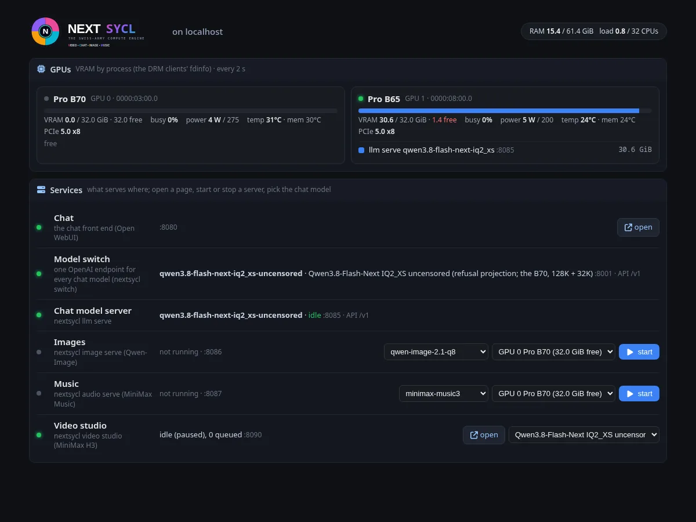
  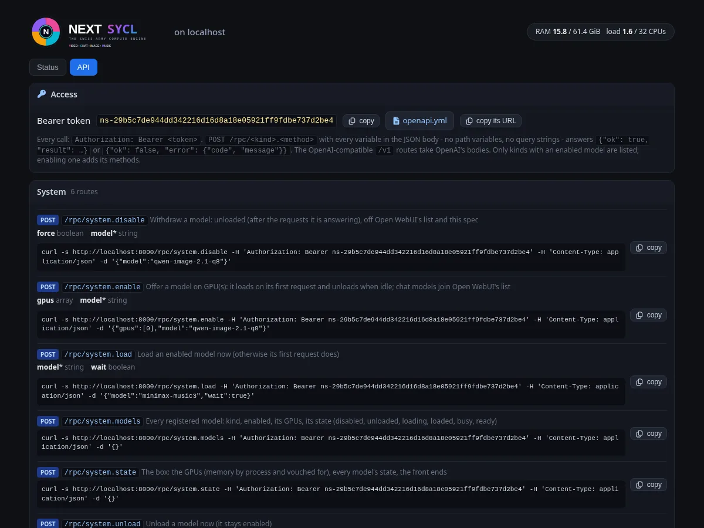
  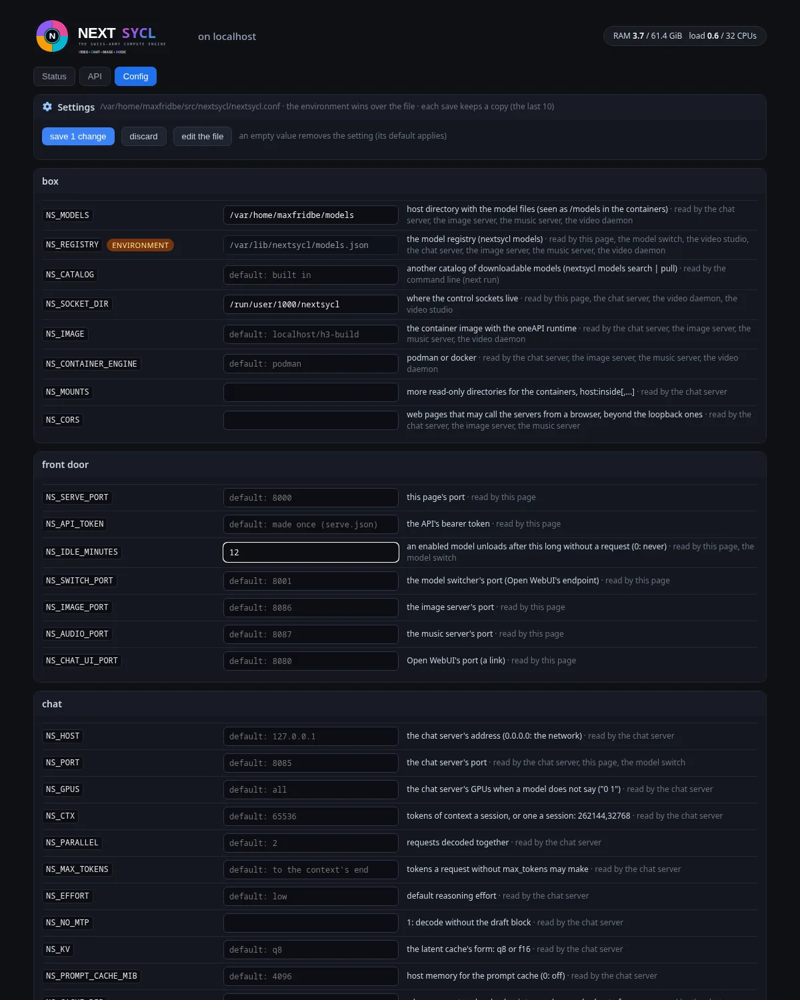

- **`switch`**: one OpenAI endpoint for a chat front end over the one model server that runs at a time. It lists the
  registry's enabled chat models (read on every request); a request naming another model asks the video studio to
  swap (`llm.mode`: it knows when a render holds a card), waits until the server answers as that model, and passes the
  request through, streamed answers included. The loaded model is not swapped out while it answers or within 90 s of
  its last request (that request gets a 409 naming it). Per entry: `tools: false` drops tool definitions, `tasks:
  false` declines a front end's background tasks. `--alias` keeps old model ids working. `--images`: the images API
  (`/v1/images/...`) goes to the image server and its model is listed while it runs - one base URL for chat and
  pictures. In maintenance mode it answers chat requests with the notice (503, `Retry-After`) and loads nothing.
- **`gpustat`**: the card's telemetry every few seconds into a JSON file the pages read: VRAM used (the DRM clients'
  `drm-resident-vram0` in /proc/*/fdinfo - root only) and total, busy %, power over a 15 s window, the power cap,
  temperatures, fan, the PCIe link it trained at and what the card and slot could do.

Example units: `docs/host/*.service.example`.

## Engine options: `--opt-NAME`

Every engine declares the options it takes beyond its kind's common ones; any command forwards them to it:
`--opt-NAME VALUE` (or `--opt-NAME` alone for a switch), NAME the option or the variable it sets. At load they set
those variables (what the engines and their kernels read; into the container too), per request they ride in the
request (`"options": {NAME: value}` in an API body). An option the engine does not take is an error that lists those
it does; `nextsycl llm engines`, `nextsycl image engines`, `nextsycl audio engines` show them all.

```sh
nextsycl image gen "a fox" --opt-int8 --opt-sigmas 1,0.9375,0.875,0.75,0.5,0.25     # int8 DiT, a 6-step schedule
nextsycl llm start qwen3.8-flash-next-iq2_xs --opt-chunk 4096 --opt-spec 4
curl localhost:8086/v1/images/generations -d '{"prompt": "a fox", "options": {"sigmas": "1,0.75,0.5,0.25"}}'
```

## Images

```sh
nextsycl models pull qwen-image-2.1-q8
nextsycl image gen "a red fox in fresh snow, morning light" [--model ID] [--size WxH | --aspect 16:9] [--steps N]
                   [--seed N] [--n N] [--sampler S] [--schedule S] [--shift X] [--cfg X --negative TEXT]
                   [--lora NAME[:SCALE]]... [--out FILE|DIR] [--rgba] [--gpu N]
nextsycl image edit "put a red knitted scarf on the fox" --image fox.png [--image ref.png]... [gen's options]
nextsycl image check <reference dump dir> [--stages te,dit,steps,vae | edit-pre,edit-te,edit-vae,edit-dit] [--gpu N]
```

**Edits and compositions.** Give the model pictures and the prompt becomes instructions: the first picture is the one
changed, the others are references the instructions name ("place the fox from picture 1 in front of the lighthouse
from picture 2"), up to 8. As Qwen-Image 2.1's pipeline does it: each picture resized (PIL's Lanczos, exactly) to
the output area at its aspect; seen by Qwen3-VL's vision tower (27 blocks, deepstack features into the first three
text layers) inside the prompt; encoded by the VAE's encoder, its latents put in the denoiser's sequence where the
prompt has the picture's slots (block-causal: text causal, each picture's block with itself and all before it). The
output takes the last picture's aspect unless a size is given. Checked against the pipeline's code at 512 and 1024
(`reference/qwenimage21/ref.py edit-*`): patches and positions exact, the vision tokens 2e-3, the VAE encoder 2e-3,
the denoiser 4e-4 over 12 steps, the picture within 6/255. An edit at 1024x1024 takes ~31 s on the B70 (40 steps;
the prefix of text and one 1024 picture is 4,119 tokens, computed once). Guidance: `--cfg` above 1 with
`--negative` (two passes a step; the pictures in both).

**Samplers and schedules.** ComfyUI's: 29 samplers (euler, euler_ancestral, heun, heunpp2, dpm_2, dpm_2_ancestral,
lms, dpmpp_2s_ancestral, dpmpp_sde, dpmpp_2m, dpmpp_2m_sde, dpmpp_2m_sde_heun, dpmpp_3m_sde, ddpm, lcm, ipndm,
ipndm_v, deis, res_multistep, res_multistep_ancestral, gradient_estimation, er_sde, seeds_2, seeds_3,
exp_heun_2_x0, exp_heun_2_x0_sde, ddim, uni_pc, uni_pc_bh2) and their schedulers (simple, sgm_uniform, karras,
exponential, ddim_uniform, beta, normal, linear_quadratic, kl_optimal) besides the model's own (`shift`), ported from
ComfyUI's code with its flow-model paths (`crates/diffusion` samplers.rs; `reference/samplers` runs ComfyUI's own
code: every sampler within 1.1e-6, every schedule within 8.3e-7). Euler on the model's schedule runs on the GPU
alone; the others step on the host (the latents, 1 MB at 1024x1024, cross each call). The ComfyUI schedules take the
model's own shift for the size unless `--shift` is given. Karras and exponential crowd the steps at the clean end,
which flow models handle badly - shift, simple, beta or normal suit them. The SDE samplers draw plain normals where
ComfyUI uses a Brownian tree: a seed gives another picture than ComfyUI's, equally valid.

`--lora` takes a registered LoRA (`nextsycl models pull qwen-image-2.1-uncensored-lora`) or a file; it is merged
into the DiT's matrices at load (PEFT, kohya and diffusers files; ~0.4 s, nothing a step), half or int8 alike, and
named in the PNG. Checked against the reference with the same LoRA merged in PyTorch: the latents after 20 steps
8.4e-4 off (without the LoRA, 3.3e-3).

Few-step models: `qwen-image-2.1-turbo-q8` (Viggle's v0.3 distill merged into the transformer: 6 steps) and the
LoRAs `qwen-image-2.1-turbo-lora`, `qwen-image-2.1-pruna-8step-lora`, `-5step-lora` each bring their own sigmas
(`NS_QI_SIGMAS`, `NS_QI_SIGMA_SHIFT` in their registry settings). All checked against the reference run with the
same files and schedules: turbo 6 steps 2.9e-3, Pruna 8 steps 2.2e-3, their images at most 2 / 4 of 255 off.
On the B70 a turbo picture takes 3.2 s: 1024x768 in half, 1024x1024 with `NS_QI_INT8=1` (6 steps, the prompt and the VAE included).

### HunyuanImage 2.1

```sh
nextsycl models pull hunyuanimage-2.1-distilled-q8      # or hunyuanimage-2.1-q8 (the base model)
nextsycl image gen 'a shop window at night, a neon sign that reads "OPEN LATE"' --model hunyuanimage-2.1-distilled-q8 [--size 2048x2048]
nextsycl image check <reference dump dir> --model hunyuanimage-2.1-distilled-q8 [--stages te,byt5,dit,steps,vae]
```

Tencent's 17B DiT (20 double-stream + 40 single-stream blocks of 3584, 2-D RoPE on the image's tokens, a token
refiner over the text) from calcuis' GGUFs: the DiT Q8_0 (kept Q8_0 on the card, each matrix expanded to half just
before its product - shared by guidance's two passes), Qwen2.5-VL-7B Q4_0 for the prompt (hidden_states[-3] under the
official template, its 34 template tokens dropped), byT5-small (float32) for the text the prompt quotes, joined as
the official reorder_txt_token does ([glyph tokens | Qwen tokens]; padding dropped - the official attention masks it),
and the 32x VAE decoder (half, run whole: the official tiling is said to spoil the picture). The distilled model runs
8 steps with its guidance embedded and MeanFlow's next timestep; the base model 50 with a negative prompt (empty by
default, as the pipeline) under the pipeline's MIX_mode_0 - CFG for 5 steps, then adaptive projected guidance
(`--opt-guidance cfg`: plain CFG). Sizes are multiples of 32; 2048x2048 is native. Not yet: the refiner, LoRAs,
edits, the glyph tokenizer's color / font tags.

Checked against `reference/hunyuanimage21/ref.py` (the official modules, pinned commit, on the same GGUFs in float32
on the CPU; 512x512, a prompt quoting "HELLO"): text encoder rel 4.9e-4 (cosine 1.000000), byT5 2.6e-7, the token
refiner 5.9e-7, double block 0 1.2e-4, after the 20 double blocks 3.0e-3, the first velocity 1.5e-3 (base model with
CFG: 8.5e-4), the latents after 8 distilled steps 2.3e-3 (base, 4 CFG steps: 3.0e-3), the VAE's picture 7.3e-4.
B70: distilled 2048x2048 1.04 s a step, 10.4 s a picture (VAE 1.65 s); 1024x1024 0.37 s a step, 3.9 s; base 2048x2048
1.99 s a step (two passes), 101.5 s; 1024x1024 0.62 s a step, 32.1 s. 25.3 GiB on the card at 2048x2048.

`gen` runs the engine in-process (the server path, `image serve | start | ps`, comes next); the PNG keeps the
prompt, model, seed, size and steps. `check` compares each stage with the dumps of `reference/qwenimage21/ref.py`.

### The image server and its web front end

```sh
nextsycl image serve qwen-image-2.1-q8 [--wfe] [--port 8086] [--host 0.0.0.0] [--gpu N] [--lora NAME[:SCALE]]...
                     [--set NAME=VALUE]... [--out DIR] [--cors ORIGIN]
nextsycl image start ...      # the same in the background (ready when it answers); image ps | logs [-f] | stop
                              # --idle-exit SECONDS: the server ends after that long without work
```

From the host it runs the build image as container `nextsycl-image` (the GPU, `dist/`, the registry, the model's and
its LoRAs' files read-only, the output directory - default `~/.local/share/nextsycl/images` - writable) and serves:

- `POST /v1/images/generations` - OpenAI's images API: `prompt`, `n`, `size`, `response_format` (`b64_json` or `url`),
  `background: "transparent"` (RGBA); and ours: `steps`, `seed`, `sampler`, `schedule`, `shift`, `cfg`,
  `negative_prompt`, `loras` (`["name:scale"]` or `[{name, scale}]` - another set reloads the model with them
  merged, ~4 s; a few-step LoRA brings its own sigmas and steps). The answer's `nextsycl` field has the seconds, steps,
  seed, LoRAs and the card's energy (Wh). Every picture is saved with its settings in the PNG.
- `GET /v1/models`, `/health`, `/v1/images/files/<f>`, `/api/info` (the model, its defaults, samplers, schedules,
  LoRAs), `/api/progress`, `/api/history`, `/api/gpu`.
- `--wfe`: the web front end at `/` (`wfe/image`, built into `dist/wfe` by `./build.sh wfe`): H3's scheme - TSX on
  vendored snabbdom, compiled offline by the vendored TypeScript, one state object, panels, H3's stylesheet - with
  every option of a request, live progress (step, s/step, time left), the card's power, VRAM and temperatures, and
  the pictures made (an earlier session's too, read back from the PNGs). `node wfe/check.mjs` smoke-tests a running
  one (every module parses, the page renders headlessly).

Screenshots for a quick look when debugging the page (`docs/screenshots/shoot.py image http://localhost:8086
docs/screenshots` retakes them):

| Idle | Running | Done |
|---|---|---|
| 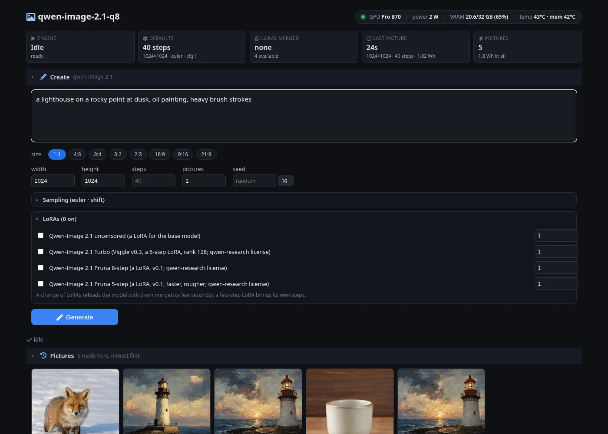 | 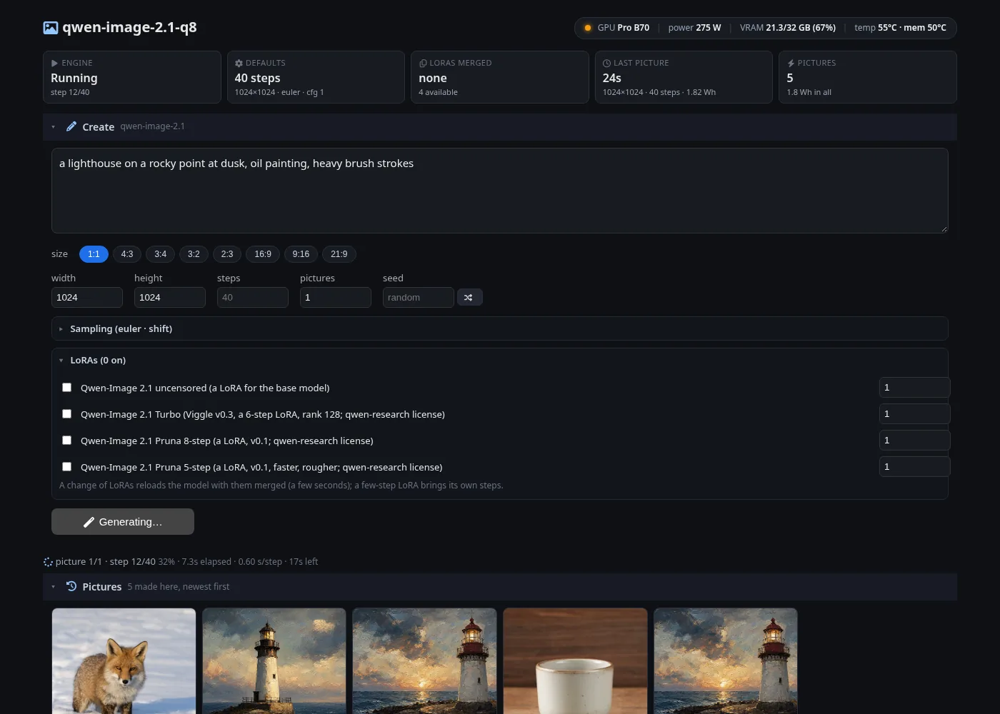 | 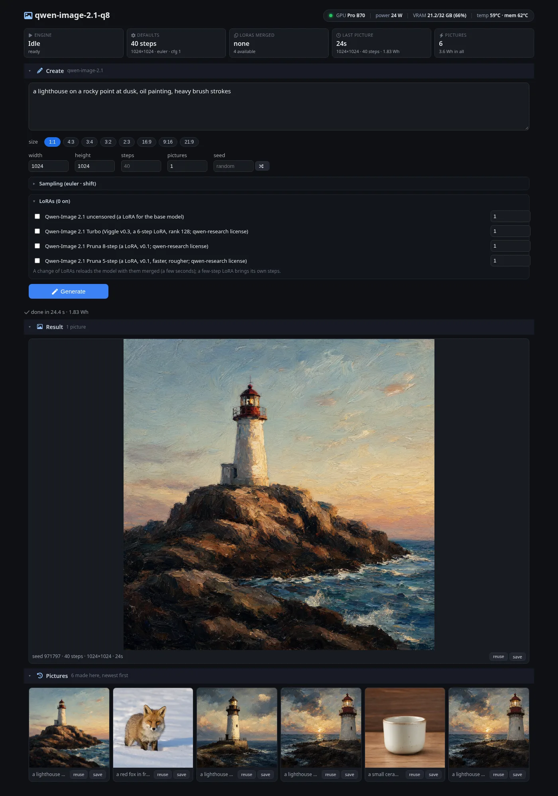 |

An edit - two pictures composed by the instructions (the page's Pictures section; "edit" on any picture made here
adds it):

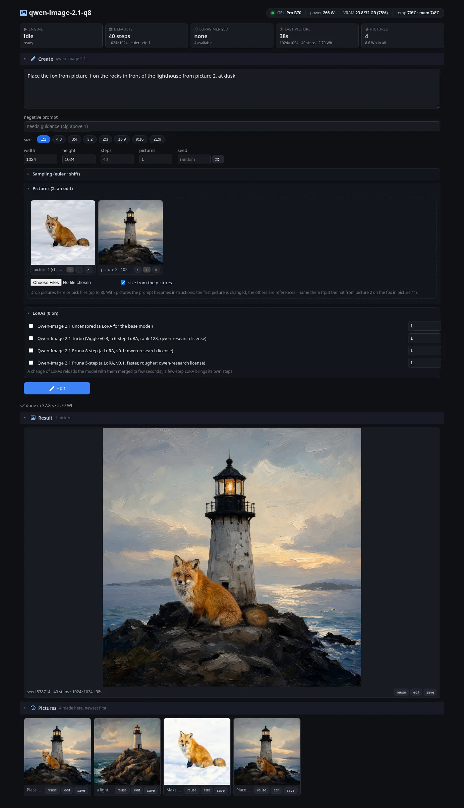

The API: `POST /v1/images/edits` takes OpenAI's multipart form (`image` / `image[]` files, `prompt` and the other
fields) or JSON with `images` (base64 or data URLs):

```sh
curl localhost:8086/v1/images/edits -F "image[]=@fox.png" -F "image[]=@lighthouse.png" \
     -F "prompt=Place the fox from picture 1 in front of the lighthouse from picture 2" -F response_format=url
```

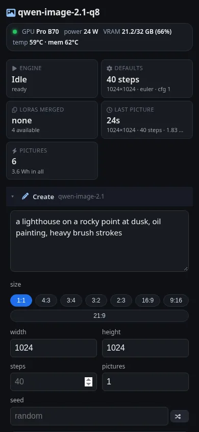

The stock model (`qwen-image-2.1-q8`, 40 steps, Euler, one picture) on each card alone, through the server
(`nextsycl image serve` timed by a client of its API, 2026-10-09). Each cell:
the request's time end to end (prompt, 40 steps, VAE, PNG) · one step of the DiT (from a 40-step and a 1-step run,
after a warm-up at that size) · the card's energy for the picture (its sensor). Load: start to the first `/health`
answer, files in the page cache.

| card, weights | load | 512×512 | 768×768 | 1024×768 | 1024×1024 | 1536×1536 |
|---|---|---|---|---|---|---|
| B70, half | 6.5 s | 5.4 s · 0.13 s/step · 0.41 Wh | 13.0 s · 0.32 s/step · 1.00 Wh | 17.4 s · 0.43 s/step · 1.33 Wh | 23.8 s · 0.59 s/step · 1.81 Wh | 62.1 s · 1.54 s/step · 4.74 Wh |
| B70, int8 (`--opt-int8`) | 7.5 s | 3.6 s · 0.09 s/step · 0.27 Wh | 8.8 s · 0.22 s/step · 0.67 Wh | 11.8 s · 0.29 s/step · 0.90 Wh | 16.5 s · 0.41 s/step · 1.26 Wh | 45.3 s · 1.12 s/step · 3.46 Wh |
| B65, half | 7.0 s | 8.5 s · 0.21 s/step · 0.47 Wh | 19.9 s · 0.49 s/step · 1.10 Wh | 27.1 s · 0.67 s/step · 1.50 Wh | 37.5 s · 0.93 s/step · 2.08 Wh | 98.4 s · 2.44 s/step · 5.46 Wh |
| B65, int8 (`--opt-int8`) | 7.5 s | 5.6 s · 0.14 s/step · 0.30 Wh | 13.2 s · 0.32 s/step · 0.72 Wh | 17.9 s · 0.44 s/step · 0.99 Wh | 25.0 s · 0.61 s/step · 1.38 Wh | 69.1 s · 1.70 s/step · 3.83 Wh |

Outside the steps a picture costs 0.1-0.5 s on the B70 and 0.2-1.0 s on the B65 (the prompt, the VAE, the PNG). The
B65 takes ~1.6x the B70's time in half and ~1.5x in int8; int8 is 1.4-1.5x faster than half on either card. The few-step
turbo model (`qwen-image-2.1-turbo-q8`, 6 steps) makes 1024×1024 in 3.2 s on the B70.

`NS_QI_INT8=1` (opt-in, in the environment or a registry entry's settings) keeps the DiT's block matrices as int8
ConvRot - each Q8_0 matrix rotated by the 256 x 256 Hadamard matrix along its inputs and quantized per row at load,
the activations quantized per row on the fly - on the card's int8 rate, twice its half one, in half the VRAM (~7 GB).
Its cost against the reference: velocity 5.8e-3 (half 3e-4), the latents after 20 steps 1.8e-2 (cosine 0.9998); the
1024x1024 fox against half's: PSNR 39.2 dB, mean pixel difference 0.57.

Where a 1024x1024 step goes on the B70 (`NS_QI_PROFILE=1`), int8: the block matrices ~50%, attention ~16% (ARK's
flash kernel on sycl-tla, `libnextsycl-flash.so`: 2.5 ms a block at 4k tokens, ~110 TFLOPS - oneDNN's fused SDPA
took 5.0; `NSD_FLASH=0` goes back to it), norms, gates, SwiGLU and RoPE ~16%. The VAE adds 0.7 s a picture (0.45 s of it its 3x3 convolutions).

## Video

MiniMax H3's engine, daemon, studio and tools (the sycl-h3 studio) as `nextsycl video`:

```sh
nextsycl models pull minimax-h3 [--dir DIR] [--from DIR]      # --from: adopt copies already on the machine
nextsycl video start [--model ID] [--engine ID]... [--gpu N ...] [--shared-gpu N ...]   # the daemon, in its container
nextsycl video serve [--bind ADDR] [--port N]                   # the studio: H3's web front end and clip queue
nextsycl video job generate --prompt "..." --width 768 --height 576 --seconds 5 --steps 8 --out DIR/clip.mp4 [-f]
nextsycl video ps [-a] | inspect ID | cancel ID... | rm ID... | status | gpus | unload [--gpu N] | logs [--web]
nextsycl video speech FILE --character NAME | scene SCENE.json | join PREFIX | speechpct CLIP... | plan measure
nextsycl video job <kind> ... --here                            # a job in this process (load, run, exit)
nextsycl video stop [--web | --all]
```

- **The engine** (`video/h3`, the `VideoEngine` contract): H3's h3-core, its jobs (generate, encode, decode,
  denoise, check-block, bench-blocks) and mp4 writer, on the diffusion kernels of `libnextsycl-video.so` (H3's under
  the `nsd_` prefix; SageAttention from `libnextsycl-flash.so`). Its options: `nextsycl video engines`.
- **The daemon** (`glue/serve` video::daemon): H3's queue, one worker process a GPU slot (it loads on the first
  job, unloads after `NS_VIDEO_IDLE`), the card lock and the front end's model switch for a GPU shared with chat.
- **The studio** (`video serve`, a host process): H3's front end (`wfe/video`, TSX on snabbdom) and its legacy API,
  the clip queue, projects, scenes, films, the language-model switch (`NS_VIDEO_LLM_MODES`).
- **Samplers**: a job's `sampler` and `schedule` take ComfyUI's names (`--sampler euler_ancestral`, `dpmpp_2m`,
  `uni_pc` ...; the same 29 samplers and 10 schedules as the image engine); without them, Euler on H3's own shifted
  schedule. The studio's Create form has both. A 3 s 768x576 clip, 8 steps on the B70 takes 46-52 s with euler,
  euler_ancestral or dpmpp_2m alike (one model call a step; heun-type samplers take two or three).
- Settings: `NS_VIDEO_MODEL`, `NS_VIDEO_ENGINES`, `NS_VIDEO_OUT`, `NS_VIDEO_GPUS`, `NS_VIDEO_SHARED_GPUS`,
  `NS_VIDEO_IDLE`, `NS_VIDEO_GPU_LOCK`, `NS_VIDEO_LLM_SWITCHER`, `NS_VIDEO_MODELS_DIR` (seen as /models: H3's paths
  in scene files, the pixel upscalers), `NS_VIDEO_LISTEN` / `_PORT`, `NS_VIDEO_STUDIO_DIR`, `NS_VIDEO_LLM_MODES`,
  `NS_VIDEO_TEMPLATES`, `NS_VIDEO_CHARACTERS` (`docs/video/characters.example.json`).
- Checked against H3's own `h3d` on the B70, the same clip: the latents differ from H3's by as much as two H3 runs
  differ from each other (cosine 0.996 - H3 is not bit-reproducible run to run), the frames the same scene; 8.0 s a
  denoising step either way at 896x672, 4.5 s (19,191 tokens).

What a clip can be made from (ComfyUI's H3 nodes, each checked against them where noted):

| Mode | How | Keys (job spec; the studio's form has each) |
|---|---|---|
| text to video+audio | the prompt | `prompt` |
| image to video, first / last frame, both | keyframes pinned at frame 0 / the last frame; their pictures shown to the text encoder too (`<Picture i>`, as ComfyUI's image-to-video node) | `first_frame`, `last_frame`, `te_pictures` |
| motion guide, clip continuation | a clip's last frames (22) anchored as one moving keyframe, its sound tail - how a film carries on; the last latent of the clip before (jumps in exposure: chain a PNG) | `guide_clip`, `first_audio`, `first_latent` |
| references (Ref2VA) | up to 9 pictures, 3 clips (their sound too) and 3 sounds named `<Picture i>`, `<Video k>`, `<Audio j>` in the prompt; the Ref2VA denoiser (`minimax-h3-ref2va`). The 32B text encoder's vision tower (`visual.*`, range-fetched from the bf16 file) runs from crates/qwen3vl - checked against ComfyUI: cosine 0.99994 | `ref_images`, `ref_videos`, `ref_audio`, `ref_image_size` |
| effects | Comfy-Org's ten embeddings: `embedding:minimaxh3_bullet_time` in the prompt (ComfyUI's splitting; cosine 0.999999) | `embeddings` (from the model's roles) |
| ControlNet (Fun ControlNet-Union 2.0) | a control video - canny, depth, HED, MLSD or pose frames, made beforehand - the clip follows | `control_video`, `control_strength`, `control_start`, `control_end` |
| video inpainting | a mask (white: regenerate; a picture or a video) over a source video, through the same ControlNet | `control_mask`, `control_source` |
| regenerate a stretch / box, extend | a clip's latents kept outside the seconds and box asked for | `source`, `regen`, `regen_box` |

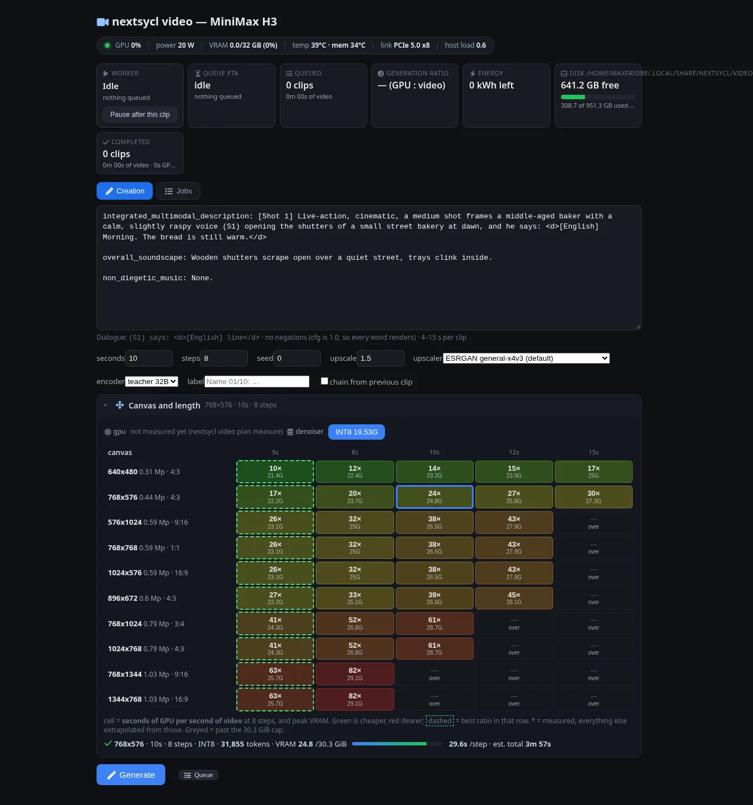

## Audio

MiniMax Music 3 (`audio/minimaxmusic3`): a song from its lyrics and a description of it - genre, tempo and key, mood,
the voice, the instruments, the arrangement.

```sh
nextsycl models pull minimax-music3 [--dir DIR] [--from DIR]   # --from: the checkpoint's directory, if downloaded
nextsycl audio gen "Genre: indie folk. BPM: 84. Vocals: male lead, gentle. Arrangement: acoustic guitar, banjo." \
                   --lyrics-file song.txt [--seconds 60] [--seed N] [--steps 30] [--cfg 1.7] [--out FILE|DIR] [--opt-int8 1]
nextsycl audio serve [minimax-music3] [--wfe] [--port 8087] [--host H] [--out DIR] [--gpu N]
nextsycl audio check <reference dump dir> [--stages ar,dit,voc,chunks] [--gpu N]
nextsycl audio engines | selftest [--gpu N]
```

Lyrics take structure tags on lines of their own (`[intro]`, `[verse]`, `[pre-chorus]`, `[chorus]`, `[bridge]`,
`[instrumental]`, `[solo]`, `[outro]`; text after a tag on its line is dropped, as the model was trained); no lyrics
makes an instrumental. `--seconds` is a limit: the model ends a song when it is done. The WAV carries the description,
the lyrics and the settings (its INFO chunk).

- **The pipeline**, one card: the prompt in the checkpoint's template and its classifier-free twin; the language
  model draws a semantic code a frame (25 a second, guidance 1.5, the best 50) and the depth decoder the seven residual
  codes after it, two rows a frame on the engine's own small-batch products and cached attention, the draws on the
  host; each frame's eight hidden states mixed into one conditioning row; the flow transformer makes the Flow-VAE
  latents in 200-frame windows 100 apart (30 Euler steps, guidance 1.7), each blended into the previous over their
  overlap; the decoder (DAC's, its convolutions on oneDNN) a window at a time, the overlaps cropped.
- **Checked** against MiniMax's own diffusers code (`reference/minimaxmusic3/ref.py`, float32 on the CPU, the same
  files), each stage from the reference's input: the prompt's tokens equal; the language model and the depth decoder
  over 51 frames forced to the reference's codes rel 4e-4 (half; int8 2-3e-2, cosine 0.9997); the condition 2e-6; the
  flow transformer's first velocity 1.4e-3 and the latents after 30 steps 1.2e-3; the decoder 8e-7; three windows
  with their overlaps, stitched, 3.6e-3.
- **The server** (`nextsycl audio serve`, the container `nextsycl-audio`): the reference server's endpoint - `POST
  /v1/audio/speech` with `input` (the lyrics), `instructions` (the description), `seed`, `max_new_tokens` (frames,
  25 a second) or `seconds`, and ours: `steps`, `cfg`, `options` - answering the WAV, or with `"response_format":
  "url"` JSON with its link; `/api/progress` (the phase: prompt, tokens, flow, decode), `/api/cancel`,
  `/api/history`, `/v1/audio/files/<f>` (byte ranges, for the player).

```sh
curl localhost:8087/v1/audio/speech -H 'content-type: application/json' -o song.wav -d '{"input": "[verse]\nCity
  lights are calling out my name\n[chorus]\nTonight we run", "instructions": "Genre: funk pop. BPM: 112. Slap bass,
  brass stabs. Vocals: confident male lead.", "seed": 11, "max_new_tokens": 1500}'
```

With `--wfe` the page at `/`: the description, the lyrics with the structure tags a click away, the length, the
seed, the steps and guidance; the phase and its progress while a song is made, a cancel; each song with its player,
settings, lyrics and the card's energy (`docs/screenshots/shoot.py audio http://localhost:8087 docs/screenshots`
retakes these):

| Idle | Composing | Done |
|---|---|---|
| 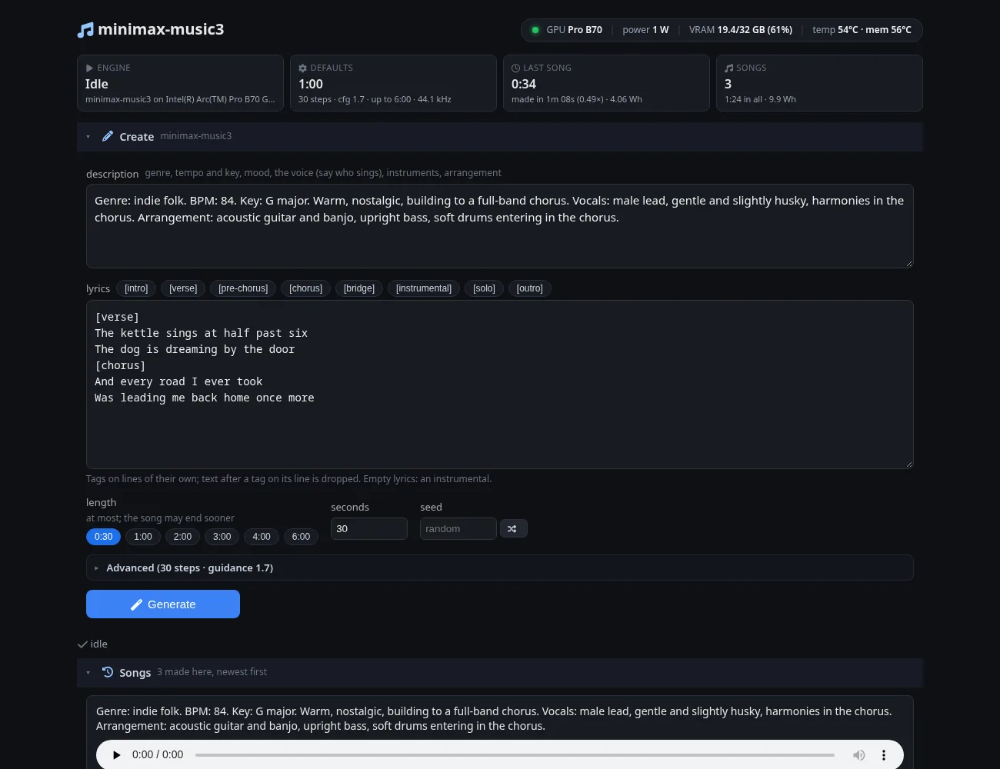 | 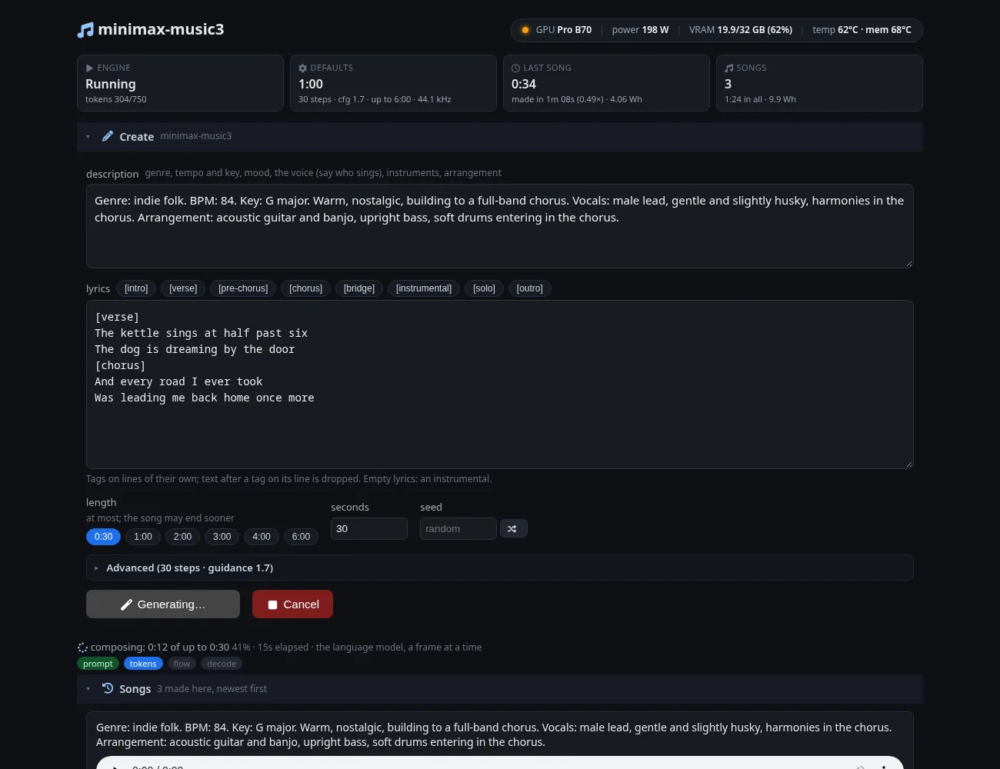 | 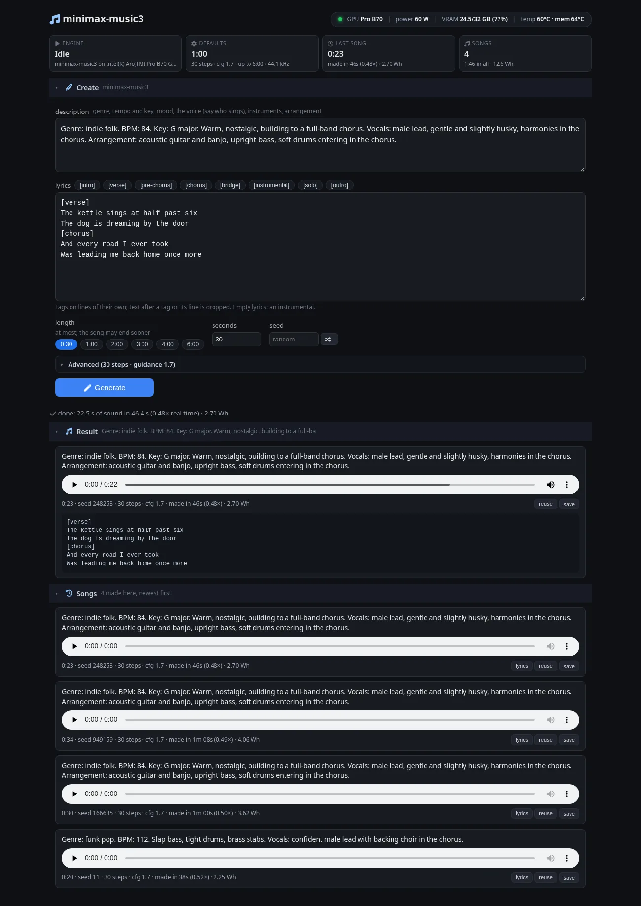 |

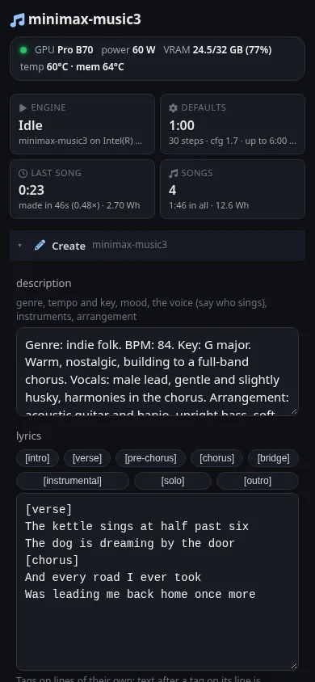

A minute of song (`nextsycl audio gen --seconds 60`, a pop-rock description and lyrics long enough not to end
sooner, 30 steps; 2026-10-09), each card alone; its phases as `gen` reports them. VRAM: the card's use with the
model loaded, and its peak over a 20 s song (the cache and the flow stage's buffers), through the server:

| card, language model | 60 s of song | tokens (1,500 frames) | flow (14 windows x 30 steps) | decode | VRAM, loaded / peak |
|---|---|---|---|---|---|
| B70, half | 117.8 s | 71.8 s · 20.9 frames/s | 42.0 s · 0.10 s/step | 3.8 s | 19.4 / 22.7 GiB |
| B70, int8 (`--opt-int8 1`) | 88.8 s | 42.7 s · 35.2 frames/s | 42.2 s | 3.8 s | 12.3 / 15.4 GiB |
| B70, int8 + flow int8 (`--opt-dit-int8 1`) | 80.0 s | 42.5 s · 35.3 frames/s | 33.5 s · 0.08 s/step | 3.7 s | |
| B65, half | 154.8 s | 89.1 s · 16.8 frames/s | 60.7 s · 0.14 s/step | 4.8 s | the same |
| B65, int8 | 136.2 s | 70.5 s · 21.3 frames/s | 60.7 s | 4.8 s | the same |

Real time is 25 frames a second: the B70 composes faster than real time in int8. `--opt-dit-int8 1` keeps the flow
transformer's block matrices as int8 ConvRot (rotated by the 256 x 256 Hadamard matrix along their inputs, quantized
per row; activations quantized on the fly): the latents after 30 steps 8.6e-3 off the reference (half 1.2e-3), cosine
0.99996. The language model's frame reads
all of its weights and, seven times, the depth decoder's (14 GB and 8 GB a frame in half) - ~78% of the B70's
memory bandwidth. A load takes 6 s with the files in the page cache (20 s from the disk). Running the flow stage
beside the frames on a second queue of the same card was tried: the card takes the two in turns (114.5 s, not less).

### Speech

Qwen3-TTS (`audio/qwen3tts`, the 12 Hz 1.7B checkpoints): text to speech in Chinese, English, Japanese, Korean, German,
French, Russian, Portuguese, Spanish and Italian, 24 kHz mono. One engine, three checkpoints: **CustomVoice** (nine
built-in voices - `vivian`, `serena`, `uncle_fu`, `dylan`, `eric`, `ryan`, `aiden`, `ono_anna`, `sohee` - and an
instruction for the read), **VoiceDesign** (the voice made up from a description), **Base** (the voice of a
recording: its x-vector alone, or with its transcript the recording itself as the example the model continues).

```sh
nextsycl models pull qwen3-tts-custom qwen3-tts-design qwen3-tts-base
nextsycl audio gen "Good morning. The bread is still warm." --model qwen3-tts-custom --voice ryan --language english \
                   [--instructions "cheerful, a little hurried"] [--seed N] [--out FILE|DIR] [--opt-int8 1]
nextsycl audio gen "The lighthouse keeper counted the ships." --model qwen3-tts-design \
                   --instructions "A calm elderly woman with a soft, slightly raspy voice, speaking slowly."
nextsycl audio gen "I never thought the garden would grow this fast." --model qwen3-tts-base --ref-audio voice.wav \
                   [--ref-text "what the recording says"]
nextsycl audio check <reference dump dir> --model qwen3-tts-custom [--stages prompt,frames,codec]

# saved voices: kept by name, spoken by any model that clones (--voice NAME, "voice": "NAME")
nextsycl audio voice add grandpa --sample grandpa.mp3 --text "Well, back in my day we walked to school."
nextsycl audio voice design narrator --instructions "A deep, warm male narrator in his fifties, unhurried." [--seed N]
nextsycl audio voice list | rm NAME
nextsycl audio gen "Chapter one." --model qwen3-tts-base --voice narrator
```

A **saved voice** is a recording and what it says, in `<audio output>/voices/<name>/`: cloned from a sample (WAV,
MP3, FLAC, Ogg Vorbis or M4A, decoded by symphonia), or designed - the front door has the voice-design model read a
ten-second line in the voice described and keeps that. A request naming it (`audio.speak`, `/v1/audio/speech`) with
no model goes to an enabled model that clones, as an in-context clone; `audio.voices.add | design | list | remove`
on the API, chips and "save voice" buttons on the page.

- **The pipeline**, one card: the prompt as qwen-tts builds it (projected text tokens plus codec control tokens: the
  language, the speaker's row - a built-in voice's embedding or the recording's x-vector - and the instruction ahead);
  the talker (a 28-layer Qwen3 of 2,048) draws a frame's first code, 12.5 frames a second, its code predictor (5 layers
  of 1,024) the other fifteen, each frame fed back with the next text token - the whole frame on the GPU as one
  recorded SYCL graph, fused kernels and the draws on the device (the engine's silo; without it the MiniMax Music
  engine's kernels with the draws on the host); the codec's decoder (an 8-layer windowed transformer,
  ConvNeXt upsampling, SnakeBeta convolution blocks on oneDNN) turns 16 codes a frame into 1,920 samples. The speaker
  encoder (ECAPA-TDNN on a 128-band log mel) runs on the host. The in-context clone encodes the recording with the
  codec's encoder (Mimi's: SEANet convolutions, an 8-layer causal transformer, split-RVQ nearest codes) and puts its
  frames under the reference transcript's tokens; the recording's frames are decoded ahead of the new ones and cut
  off, as qwen-tts does.
- **Checked** against qwen-tts' own code (`reference/qwen3tts/ref.py`, float32 on the CPU, the same files): the prompt
  rows rel 9e-5 to 2e-4, the first frame's logits 3e-4 to 8e-4; greedy frames identical to the reference's (VoiceDesign
  46 of 46, a clone 59 of 59; CustomVoice all 16 codes through frame 143 and 2,046 of 2,047 first codes, half-precision
  drift after); with the reference's frames forced, the first code differs in 0 of 2,047 frames and the others in 1 of
  30,705 (a near tie - the greedy runs part there); the codec 1e-6 to 1.7e-3; the clone's speaker embedding 8e-7; the
  recording's codes from the encoder 1,152 of 1,152. Every mode's speech transcribes word for word (Whisper); a clone
  is 0.990 (x-vector) / 0.992 (in context) like its recording by the speaker encoder's cosine, another voice 0.943.
- **Speed** (2026-10-18; a 70-word paragraph, sampled, seed 7; the frames on the device as one graph): the B70 makes
  82 frames/s in half (6.6x real time), 125 with `--opt-int8 1` (10x); the B65 72 / 94 (before the graph, 2026-10-09
  path: B70 70 / 93, B65 66 / 71). Through the audio server (B70, half): "Good morning. The bread is still warm."
  answers in 0.64 s (3.6 s of speech), a minute of speech takes 0.18x its length (0.14x int8); B65 0.65 s, 0.22x
  (0.18x). A frame reads 5.3 GB of weights in half (2.8 GB int8); at the 530 GB/s a product reaches on the B70 that
  is 10 ms (5.3 ms) a frame - the frame takes 12.3 ms (8.3 ms), the rest the ~550 small kernels' ramps, the
  attention and the draws. The codec decodes a minute in ~0.9 s after its chunk lengths' first use (two are made at
  load: +1.4 s). A model loads in 2-3 s from the page cache.
- **Served** by the same audio server (`nextsycl audio serve qwen3-tts-custom --wfe`) and `:8000`'s `audio.speak`:
  `/v1/audio/speech` with `input` (the text), `voice`, `language`, `instructions`, `ref_audio` (a WAV, base64 or a
  data: URL), `ref_text`, `seconds` (the most), `seed`, `options` (`greedy`, `temperature`, `top-k`, `streaming`).
  The page takes the text, the voice (chips), the description or instruction, a recording to clone and its
  transcript, the language.

### Breeze TTS 2

Breeze TTS 2 (`audio/breezetts2`, BreezeBlue's CSM fork, ~3B; CrispASR's GGUF of it): English and Chinese speech at
24 kHz. A T5Gemma2 text encoder (26 layers, bidirectional, a symmetric sliding window) reads each text segment of the
prompt; a Qwen3 backbone (28 layers) draws a frame's first code, a 12-layer depth decoder the other fifteen of the
Qwen3-TTS 12 Hz codec (the same codec file, shared through `crates/codec12hz`). Four ways: **design** (`--instructions`:
the voice described, in the language of the text), **clone** (`--ref-audio` + `--ref-text`, the exact transcript),
**direction** (a clone + `--instructions`: tone, emotion, pace), plain; guidance `--cfg` 4 with an instruction. Vocal
events inline: `(laugh)`, `(sigh)`, `(cough)`, `(clears throat)`; `[笑]`, `[叹气]`, `[咳嗽]`, `[清嗓子]`. **License:
the weights and their outputs are research and non-commercial only** (BreezeBlue Research and Non-Commercial License
1.1); the upstream code is Apache-2.0.

```sh
nextsycl models pull breeze-tts-2
nextsycl audio gen "(sigh) Welcome aboard. Your journey begins now." --model breeze-tts-2 \
                   --instructions "A warm, thoughtful young woman with a clear voice and a calm, reflective delivery."
nextsycl audio gen "[叹气] 没想到过了这么久，你还记得我的声音。" --model breeze-tts-2 --ref-audio r.wav --ref-text "..." \
                   [--instructions "用激动的语气，语速稍快。"] [--cfg 4] [--seed N] [--opt-temperature 0.9]
nextsycl audio check <reference dump dir> --model breeze-tts-2 [--stages prompt,frames,codec]
```

- **Ported**: the GGUF's matrices expanded to half at load (F16 / Q8_0 / Q4_0 / Q4_K on the host; the text embedding
  read from the file a row a token); the backbone and depth decoder on the music engine's cached decode (the depth
  decoder's guided pair as one batch of two); this engine's kernels (`kernels/audio/breezetts2`) for the text encoder's
  windowed bidirectional attention, its GELU-tanh gate and the table-driven RoPE; the prompt of upstream's four
  templates; Gemma's tokenizer (`nextsycl_tok`, SentencePiece-style).
- **Checked** against upstream's own code (`reference/breezetts2/ref.py`, float32 on the CPU, greedy; prompts of all
  four templates, English and Chinese): token ids identical; the recording's codes 1,152 of 1,152; with the f16 GGUF
  the text encoder 4-5e-4, the prompt rows 7-9e-4, each frame's backbone logits 4e-4 and depth logits 8-9e-4 (teacher
  forced: no first code differs); with the served Q8_0 file 6e-3, 7-1e-2, 3-5e-3 and 8e-3 (its quantization); the
  codec 1.4-5e-6. Real clips in every mode, English and Chinese, transcribe word for word (Whisper small).
- **Speed** (B70, 2026-10-16): 22 frames a second with guidance (design, direction: 1.8x real time), 28 without
  (clone: 2.2x); 5.4 s of designed speech in 3.9 s with the decode. 5.4 GiB of weights, 6.1 GiB in a run.
- **One server a card**: two Breeze servers on one card make less than half the audio one does (B70 1.54x real time
  alone, 0.65x for the pair: the driver time-slices them). Several clips in one engine instead (batched decode, ~3-4x
  estimated) is a proposal for review: `docs/proposals/speech-batching.md`.

### VibeVoice

VibeVoice-1.5B (`audio/vibevoice`, Microsoft; gguf-org's GGUF of it): long-form, multi-speaker speech in English and
Chinese at 24 kHz. A script of up to four speakers (`Speaker 1: ...`, a turn a line) is read by a Qwen2.5-1.5B
language model; for each 7.5 Hz frame a diffusion head draws a 64-value acoustic latent (10 DPM-Solver++ steps, guided
by a second, negative run of the language model: `--cfg`, 1.3), the σ-VAE acoustic decoder turns it into 3,200
samples, and the semantic encoder reads them back for the next step. Each speaker's voice is cloned from a recording
(no transcript needed: `--ref-audio` once a speaker in order, or saved voices `--voices NAME,NAME`); a speaker without
one gets a voice of the model's own. The model ends the speech itself (up to 90 minutes). **License: MIT; Microsoft's
model card restricts its use - no imitation of a real person's voice without their consent, no passing its speech off
as real, disclose that the audio is AI-generated.**

```sh
nextsycl models pull vibevoice-1.5b
nextsycl audio gen "Speaker 1: Welcome back to the show.\nSpeaker 2: Thanks for having me." --model vibevoice-1.5b \
                   --ref-audio host.wav --ref-audio guest.wav [--cfg 1.3] [--steps 10] [--seed N]
nextsycl audio gen "Good morning. The bread is still warm." --model vibevoice-1.5b [--voice SAVED]
nextsycl audio check <reference dump dir> --model vibevoice-1.5b [--stages prompt,lm,head,codec,run]
```

The audio server and the front door take a script's voices as `voices` (saved voices) or `ref_audios` (recordings), a
speaker each in order; `audio.speak` picks a model of several speakers (card `speech: speakers`) for them.

- **Ported**: the language model's matrices kept Q8_0 on the card (codes and block scales), the tokenizers' the file's
  bfloat16, the head and connectors half; the token embedding read from the file a row a token, the tied head's four
  tokens on the card; the tokenizer and config.json from the -hf checkpoint. All on the engine's own kernels
  (`kernels/audio/vibevoice`): the language model's decode step (8 launches a layer, its two guidance branches in one
  paired pass, the attention split over the keys), the diffusion head's ten steps without a read-back (every step's
  modulations in one product a frame, DPM-Solver++ on the device), the tokenizers streaming a frame at a time (each
  convolution a product over windows of its carried rows and input, the high stages on the matrix engines with x split
  into two bfloat16 halves: float32-accurate).
- **Checked** against transformers' implementation (`reference/vibevoice/ref.py`, float32 on the CPU; its loop
  bit-identical to `generate`'s frames): token ids identical; with the f16 GGUF the language model's logits 2-5e-4 and
  hidden states 0.7-2.2e-3 / 5-6e-4 teacher forced (every token agrees), with the served Q8_0 2e-3 and 1.4-2e-2 (its
  quantization); the diffusion head 4e-7, the acoustic decoder 2-3e-6, the semantic encoder 4e-6 to 8e-5, the voice
  encoder 2-9e-6; Chinese token ids identical, and a run that splits into two audio segments (the negative branch's
  restart, the streams' reset) as close. Clips plain, cloned, two-speaker and a 46 s show transcribe word for word
  (Whisper small; twelve seeds of the show: 1.2% word error); the speakers alternate as cast (pitch).
  `docs/ports/vibevoice.md` has the details.
- **Speed** (2026-10-18): 79.3 frames a second on the B70 (10.6x real time: 46.5 s of a two-speaker show in 4.9 s with
  the prompt; 5.9 s through the server), 64.0 on the B65 (8.5x; 7.1 s through the server). A short sentence through
  the server 0.31 s (B70) / 0.38 s (B65). A frame on the B70 is 12.6 ms against a floor of 6.4 ms of weights read
  (`docs/ports/vibevoice.md`: what is left). 3.6 GiB of weights, 4.0 GiB in a run.

### S2 Pro

Fish Audio S2 Pro (`audio/s2pro`, ~4.6B; s2.cpp's GGUF of it, the codec in the same file): speech in about 80
languages at 44.1 kHz (best in English, Chinese and Japanese). A Dual-AR model: a 36-layer Qwen3 slow model draws each
frame's semantic code, a 4-layer fast model the other nine of Fish's RVQ codec (21.5 frames a second). What it really
does:

- **clone** (`--ref-audio` + `--ref-text`, the exact transcript; or a saved voice with one): yes. Without the
  transcript it does not clone (upstream drops the recording).
- **direction**: yes, by S2 Pro's own mechanism - free-form tags in square brackets anywhere in the text (`[whisper]`,
  `[laughing]`, `[excited tone]`, `[pause]`, `[pitch up]` ...; 15,000+ in training). `--instructions` becomes such a
  tag at the start of the text (and of each speaker turn).
- **vocal events**: yes, as tags (`[laughing]`, `[sigh]`, `[inhale]`, `[clearing throat]`, `[chuckle]`, `[panting]` ...).
- **several speakers**: yes, `<|speaker:0|>`, `<|speaker:1|>` turns in one text, read in batches that carry the
  conversation on.
- **design**: no (no description input, no built-in voices). Without a recording the voice is the model's pick for
  the text, and it changes with the seed.

**License: the weights and their outputs are research and non-commercial only** (Fish Audio Research License;
commercial use needs Fish Audio's written license).

```sh
nextsycl models pull s2-pro
nextsycl audio gen "Hello! [laughing] Isn't that something?" --model s2-pro [--seed N]
nextsycl audio gen "I have a secret to tell you." --model s2-pro --ref-audio r.wav --ref-text "..." [--instructions "whisper"]
nextsycl audio gen "<|speaker:0|>Did you hear that? <|speaker:1|>[whisper] Hear what?" --model s2-pro
                   [--opt-temperature 0.7] [--opt-top-p 0.7] [--opt-top-k 30] [--opt-greedy 1]
nextsycl audio check <reference dump dir> --model s2-pro [--stages prompt,frames,codec]
```

- **Ported**: the GGUF's matrices kept as Q8_0 on the card (int8 codes and half scales), read by this engine's own
  decode product (`kernels/audio/s2pro`). A prompt's wide products expand them to float32 for oneDNN's GEMM - half
  overflows on some prompts' activations.
  - The embeddings stay in the file (a row a token; a frame's 11 rows summed).
  - fish-speech's RoPE on interleaved pairs with its bfloat16 table.
  - The attention, cache and embeddings on the music engine's kernels.
  - Fish's codec (decoder, encoder, quantizers) in float32 on the Qwen3-TTS codec's and the shared kernels.
  - fish-speech's conversation prompt, speaker batches, inline-tag instructions, and its draws (top-p before the
    temperature, repetition-aware resampling).
- **Checked** against fish-speech's own code (`reference/s2pro/ref.py`, float32 on the CPU, greedy; plain, clone,
  Chinese, a 170-token paragraph):
  - prompts identical; the recording's codes 2,137 of 2,140 (every semantic code)
  - with the F16 file, the slow logits 1.1-1.3e-4 and the fast logits 0.4-1.3e-4, teacher forced; greedy frames
    identical (40 / 40, 30 / 30) up to a near tie
  - with the served Q8_0 file, 6e-3 and 1-5e-3 (its quantization)
  - the codec 7e-7 .. 2e-6 against the reference with the GGUF's half weights (5-8e-4 against codec.pth's float32)
  - real clips in every mode, English, Chinese, Japanese, a dialogue, transcribe word for word (Whisper small)
  - details: [docs/ports/s2pro.md](docs/ports/s2pro.md)
- **Speed** (B70, 2026-10-17): 42 frames a second (2.0x real time for the frames); a 42.8 s paragraph in 24.4 s with
  the decode (1.75x). 5.6 GiB on the card loaded, 6.5 GiB at a long clip's peak.
- **Served** like the other speech models: `nextsycl audio serve s2-pro` (`/v1/audio/speech`: `input`, `ref_audio` +
  `ref_text` or a saved `voice` with its transcript, `instructions` as a tag, `seconds`, `seed`, `options`) and
  `:8000`'s `audio.speak`.

### Voxtral TTS

Voxtral 4B TTS 2603 (`audio/voxtraltts`, Mistral; CrispASR's GGUF of it): speech at 24 kHz in English, French,
German, Spanish, Italian, Portuguese, Dutch, Arabic and Hindi, in 20 **preset voices** - `neutral_female` (the
default), `neutral_male`, `casual_female`, `casual_male`, `cheerful_female`, and a female and a male voice for each
other language (`fr_female`, `de_male`, ... ; Arabic `ar_male` only). A Ministral 3B backbone (26 layers) makes a hidden
state per 12.5 Hz frame; a 3-layer flow-matching transformer turns it into the frame's semantic code and 36 acoustic
levels (7 guided Euler steps, `--cfg` 1.2); the Voxtral codec's decoder makes 240 samples a frame. `--language` alone
picks that language's voice. **What it does not do**: the open checkpoint ships the codec's decoder but not its encoder
(no `audio_tokenizer.encoder_blocks` / `input_proj` tensors; vllm-omni refuses `ref_audio` for it), and its prompt has
no instruction - so **no cloning from a recording, no voice design or direction, no vocal events**. **Experimental:**
a saved voice can be **enrolled** (`nextsycl audio voice enroll NAME`: its codes fitted through the released decoder
with PyTorch XPU, ~1-2 minutes a voice on a B65) and is then spoken as `--voice NAME`; it measured closer to the
speaker than the nearest preset for all four voices tried, a little below Breeze's and VoxCPM2's clones
(`docs/ports/voxtraltts.md`). **License: CC BY-NC 4.0** - the weights, the preset voices and the speech they make are
non-commercial.

```sh
nextsycl models pull voxtral-4b-tts
nextsycl audio gen "The quick brown fox jumps over the lazy dog." --model voxtral-4b-tts --voice casual_male
nextsycl audio gen "Le soleil se couchait lentement sur la mer." --model voxtral-4b-tts --language french \
                   [--cfg 1.2] [--steps 7] [--seed N]
nextsycl audio check <reference dump dir> --dir <f16 GGUF dir> [--stages prompt,frames,flow,codec]
nextsycl audio voice enroll NAME [--gpu N]          # experimental; NS_VXT_CHECKPOINT / NS_VXT_VLLM_OMNI / NS_VXT_TORCH
nextsycl audio gen "..." --model voxtral-4b-tts --voice NAME
```

- **Ported**: the GGUF's matrices expanded to half at load (q and k rows reordered so the rotate-half RoPE kernel
  turns the checkpoint's adjacent pairs); the backbone on the music engine's cached decode and Breeze's RoPE; the
  acoustic transformer's two guidance passes as one batch of six rows with the whole ODE on the GPU; this engine's
  kernels (`kernels/audio/voxtraltts`) for the codec's causal ALiBi attention, its whole-row q / k norms and causal
  padding; Tekken (tiktoken BPE) in `nextsycl_tok`; vllm-omni's loop and codec where CrispASR's runtime differs (ALiBi
  slopes, the window's W + 1 keys, replicate padding, 375-frame decode chunks, frame 0 from the prompt's last position:
  `docs/ports/voxtraltts.md`).
- **Checked** against upstream's own code (`reference/voxtraltts/ref.py`: vllm-omni's acoustic transformer and codec
  run as they are, float32 on the CPU from the safetensors; English and French): token ids identical; with the f16
  GGUF the prompt rows 3e-9, each frame's hidden state 3-6e-4 and semantic logits 1-2e-4 teacher forced (no semantic
  code differs, 2-3 of thousands of acoustic levels), the flow alone 5e-7..2e-6 (no level differs), the codec 5.5e-4.
  Clips in all nine languages transcribe word for word (Whisper small).
- **Speed** (B70, Q8_0, 2026-10-17): 30 frames a second, 2.4x real time; 34.6 s of speech in 15.2 s with the prompt
  and decode. 6.8 GiB of weights, 7.2 GiB in a run. B65: 22 frames a second.

### VoxCPM2

VoxCPM2 (`audio/voxcpm2`, OpenBMB's 2B checkpoint): tokenizer-free speech in 30 languages at 48 kHz. No audio tokens:
each step makes a patch of four AudioVAE latents by flow matching (a 12-layer local DiT, 10 Euler steps, guidance 2.0
with CFG-zero*), conditioned on a MiniCPM4 base language model (28 layers; its outputs at audio positions through a
scalar quantizer) and a residual one (8 layers), the patch fed back through a 12-layer local encoder; a stop head ends
it. A description in `instructions` designs the voice (put in parentheses ahead of the text, as the model was
trained); a recording is the reference (isolated by its own tokens); with its transcript also the prompt it continues
(the "ultimate" clone).

```sh
nextsycl models pull voxcpm2
nextsycl audio gen "Bonjour à tous." --model voxcpm2 [--instructions "A cheerful young French woman"] [--ref-audio r.mp3 [--ref-text "..."]]
                   [--voice SAVED] [--steps 10] [--cfg 2] [--seed N] [--opt-int8 1]
nextsycl audio check <reference dump dir> --model voxcpm2 [--stages prompt,prefill,patches,vae]
```

- **Ported**: the two language models and the local transformers on the music engine's kernels (attention now also 8
  query heads a key head) and this engine's (`kernels/audio/voxcpm2`: the long-RoPE table, attention within short
  groups of rows, Snake, the dilated causal depthwise convolution); AudioVAE V2 (weight-normalized causal convolutions,
  the 48 kHz sample-rate conditioning) on oneDNN; its weights from `audiovae.pth` read by a small ZIP + pickle reader
  (`pth.rs`: no Python); the tokenizer's SentencePiece-style BPE (byte fallback, Chinese words split into characters as
  the reference does).
- **Checked** against voxcpm's own code (`reference/voxcpm2/ref.py`, float32 on the CPU, its noise recorded): prompt
  tokens identical (plain, design, clone); the recording's latents rel 1.6e-6; both language models' prefill 4e-4 to
  1e-3; each patch from the reference's history and noise 1e-3 to 4e-2 (cos 0.99996+); the VAE 1.3e-6 to 2.8e-6.
  Run free, the half-precision differences grow through the quantizer and the guidance until a run takes another
  (equally valid) path - as two runs of the reference in two precisions do. Every mode's speech transcribes word for
  word (Whisper; Chinese and French too); a clone is 0.98 like its recording, another voice 0.92.
- **Speed** (B70, 2026-10-10): 22 patches a second (6.25 is real time): 9.9 s of speech in 3.2 s, the decoder 0.4 s.

### Qwen3.8-27B (dense)

`qwen35` (`llm/qwen35`, `kernels/llm/qwen35`): Qwen's dense Qwen3.8 / Qwen3.5 family as llama.cpp's `qwen35` graph has
it - 64 layers, three of every four gated DeltaNet (the conv + SiLU, the delta-rule recurrence, a SiLU-gated norm),
the fourth gated full attention (24 / 4 heads of 256, a sigmoid gate a head in the query projection, q / k norms,
rotary positions on 64 of the 256 features at theta 1e7), each with a dense SwiGLU of 17,408. The weights stay in
their GGUF blocks: decode multiplies them through the Q8_1 products (the same as GLM's and Qwen3.8-Flash-Next's), a
prompt chunk expands each matrix to half for the GEMM; the delta-rule scan, conv, norms and SwiGLU are the glm5next
engine's kernels (GDN is KDA with one decay a head), the attention and the gates this engine's.

- **Checked** against llama.cpp (CPU, the same Q8_0 file, `reference/llama-dump`): every layer's output cosine
  0.99993 or better, the final norm 0.99993, the same next token at the same logit; decoding the last token alone
  after the rest agrees with the whole prompt at once (0.99997). The greedy continuation of a prompt agrees with
  llama.cpp's until two candidates sit within 1% of each other.
- **Speed** (one B70, 2026-10-11, 1fecf2b; `llm generate --ids` of the benchy v1 prompts, 128 greedy tokens, MTP on - the
  default), prompt read / decode, tokens/s:

  | File | 20 | 2,185 | 8,000 | 40,000 | 2,185 without MTP |
  |---|---:|---:|---:|---:|---:|
  | Q8_0 | 57 / 42.9 | 1,014 / 44.9 | 1,044 / 39.9 | (32K context) | 1,178 / 18.5 |
  | UD-Q4_K_M | 60 / 59.5 | 1,184 / 57.4 | 1,245 / 55.6 | 772 / 46.9 | 1,195 / 27.3 |
  | UD-Q3_K_XL | 60 / 55.1 | 1,180 / 58.9 | 1,243 / 57.3 | 772 / 48.5 | 1,193 / 29.0 |

  A coding answer (400 tokens) decodes at 61 tok/s on UD-Q4_K_M and UD-Q3_K_XL. 84-89% of the drafts are accepted;
  prompts read a little slower with MTP (the draft block follows every pass; Q8_0's chunks are 1,024 rows beside it).
  Q8_0 decode is bandwidth-bound (27 GiB a token). With the shared kernels alone (`NS_SILO=0`, no drafts) UD-Q4_K_M
  reads 2,185 tokens at 441 tok/s and decodes at 18.5.
- **MTP:** the draft block (block 64 of the MTP file - `MTP/` beside the model, the catalog's `q27-mtp`, or
  `NS_Q35_MTP`) reads each position's normed hidden state with the token after it. It runs behind every pass over
  that pass's rows, so its cache follows the conversation; `step` drafts `NS_Q35_DRAFTS` tokens (3: 2 is as fast, 4
  and 5 slower), verifies [token, drafts] in one pass and keeps what the sampled tokens match, so what is committed
  is distributed as plain sampling. Verify rows are bit for bit the one-token decode's (`spec-check --rows 2..4`).
  `--no-mtp` turns it off. Q8_0 with MTP fits its catalog 32K context on one card, not 40K.
- **Two cards** (`--gpu all`, or `--gpu 1,0`: the B65, then the B70; the `-256k` catalog entries): the layers split
  so the last GPU (the server orders them weakest first) takes as many as fit beside the head, the draft block and
  the planned context's caches, and the one before it the rest - a GPU the layers do not reach is not used, so a
  context that fits the B70 runs there alone. Each GPU has its own work memory; a pass's rows cross once (through
  host memory, ~0.5 ms a token). `NS_SPLIT=N` puts layers N.. on the last GPU. The same tokens as one card
  (`spec-check --rows 4`: 0 difference). It is for room, not speed (the B65 runs a layer ~1.5x slower than the B70),
  prompt read / decode, tokens/s, MTP on:

  | File, context planned | 2,185 | 8,000 | 40,000 |
  |---|---:|---:|---:|
  | Q8_0, 256K + 32K (B65 layers 0-26) | 990 / 37.8 | | 588 / 29.0 |
  | UD-Q4_K_M, 256K + 32K (B65 layers 0-15) | 1,061 / 52.1 | 1,099 / 48.8 | 666 / 39.3 |

  Q8_0's 40K figure is from a split with layers 0-32 on the B65 (before the last GPU filled first).
- **Its silo** (`kernels/llm/qwen35/silo`, kernels tuned for this model): decode products for the types these files
  hold (Q4_K 507 GB/s against Strata's 366, IQ4_XS ~490 / 361, Q5_K 525 / 415, Q3_K 380 / 89, IQ3_S 439 / 118 - the
  same outputs), flash attention on XMX for prompts and, its keys split over work-groups, for decode, the
  weight expansion to half at ~300 GB/s for every type (Q6_K's went through float32 at 13-15), a norm that hands the
  products their Q8_1 blocks; prompt chunks of 2,048 when they fit. `NS_PROFILE=gpu NS_Q35_PROFILE=1` times every
  kernel on the device against the card's ceilings. Sessions check their cache against the free VRAM before
  allocating (1.5 GiB spare).
- Not yet: pictures (the vision tower: `mmproj`).

### Nemotron 3.5 Super (hybrid Mamba-2 / latent MoE)

`nemotronh` (`llm/nemotronh`, `kernels/llm/nemotronh`, its silo `kernels/llm/nemotronh/silo`): NVIDIA's
Nemotron-H MoE as llama.cpp's `nemotron_h_moe` graph has it - 88 layers: 40 Mamba-2 mixers (conv 4, 128 heads of 64,
8 groups, state 128, a SiLU-gated group norm), 40 latent MoE layers (a float32 sigmoid router with a selection bias,
22 of 512 experts, the experts in a 1,024-wide latent with ReLU-squared, a shared expert on the full width) and 8
attention layers without positions (32 / 2 heads of 128); its MTP block drafts. Served; text only (the vision tower not yet).

- **Checked** against llama.cpp (CPU, the same files, `llm check`): the same next token, the output logits cosine
  0.99998 (Q2_K_XL) / 0.99999 (IQ1_M); verify rows the one-token decode's (`spec-check`: 0 of 66 flips).
- **Decode**: the silo routes on the GPU and multiplies all of a layer's chosen experts in one launch per projection
  (the 2,688-wide downs repacked into aligned rows); the dense matrices (Q6_K Mamba projections, K-quant shared
  experts) through the silo's own decode products (the qwen35 silo's, copied, with a Q6_K kernel: ~520 GB/s on the
  B70), one quantize feeding both activation layouts. MTP drafts 2 a step (`NS_NH_DRAFTS`), the Mamba states
  snapshotted for the verify's rollback.
- **Prompts**: chunks of 2,048 rows when they fit; dense matrices expanded to half for the GEMM; the routed experts on
  XMX in one launch a projection (rows sorted by expert after a GPU routing pass; a work-group takes 64 rows of one
  expert, its lanes decode the quantized weights 128 inputs at a time into a half tile in local memory, each sub-group
  multiplies its 16 rows against all 64 columns; the up's output written as ReLU-squared half); the Mamba scan in
  64-row chunks (Mamba-2's chunked form: the in-chunk part as small products, the state carried over the chunks);
  flash attention on XMX; on two cards the layers split by measured speed (`NS_NH_SPEED`), the GPUs pipelined over
  the chunks.
- **One card**: `--gpu 0` keeps the MoE layers' experts that do not fit in pinned host memory and gathers the chosen
  ones into VRAM before each product (`NS_NH_HOST`).
- **Speed** (2026-10-15, 6913713 + the conv; `nemo-sweep`: benchy v1 prompts, 128 greedy tokens, MTP on), prompt
  read / decode, tokens/s:

  | File, GPUs | 20 | 2K | 8K | 40K | 128K |
  |---|---:|---:|---:|---:|---:|
  | UD-IQ1_M, B65 + B70 | 62 / 46.1 | 884 / 47.0 | 1,431 / 45.7 | 1,472 / 44.0 | 1,120 / 37.6 |
  | UD-Q2_K_XL, B65 + B70 | 54 / 41.7 | 789 / 39.6 | 1,141 / 41.9 | 1,134 / 38.5 | 868 / 34.3 |
  | UD-IQ1_M, B70 alone (host-memory experts) | 44 / 20.9 | 447 / 21.3 | 562 / 19.6 | | |

  Without drafts: Q2_K_XL 30.0, IQ1_M 31.8 tok/s decode. Strata on the same B70 reads ~880 (2K) / 1,400 (8K) and
  decodes ~30. On the B70 alone (`nemotron-3.5-super-iq1m-b70`, the B65 left free) 13 MoE layers' experts (15.5 GiB)
  sit in pinned host memory, gathered into VRAM each step; its prompt passes still expand experts one at a time. Open: the expert up products at decode (IQ3_XXS / IQ2_S / IQ1_S at ~150 GB/s on the B70, a third of the dense
  ones - neither the grid lookups nor the index math; `NS_NH_PROFILE=1` times every kernel), the vision tower.

## 3D

Hunyuan3D (`model3d/hunyuan3d`): a mesh (GLB) from one picture of an object. **hunyuan3d-2mini-turbo** makes the
shape in seconds; **hunyuan3d-2.1** makes a finer shape and paints it (base colour and metallic-roughness in a UV
atlas).

```sh
nextsycl models pull hunyuan3d-2mini-turbo        # or hunyuan3d-2.1
nextsycl model3d gen picture.png --model hunyuan3d-2mini-turbo [--seed N] [--resolution 380] [--faces 40000]
nextsycl model3d gen picture.png --model hunyuan3d-2.1 --texture [--texture-size 2048]
nextsycl model3d check <reference dump dir> --model ID [--stages ...]    # reference/hunyuan3d
```

A picture with transparency is cut out by its alpha; an opaque one by its near-uniform border colour (the shared
background remover will take over). The shape: the picture recentred, DINOv2's tokens, the DiT's latents, the
ShapeVAE's occupancy on a grid decoded coarse to fine near the surface, marching cubes, small pieces dropped,
decimated to `faces`. The texture: six views' normal and position maps, the 2.5D multiview UNet's albedo and
metallic-roughness views (15 UniPC steps, three-way guidance), baked into a fresh atlas, unseen texels filled from
the mesh.

- **Checked** against Tencent's own code in float32 on the CPU (`reference/hunyuan3d/`, the same files), each stage
  from the reference's input. 2mini-turbo: the conditioner rel 3.7e-3 (cos 0.999993), the DiT's double block 0
  2.9e-4 / 4.7e-4, its velocity at every step 6e-4 - 2.3e-3, five steps 1.5e-2 (cos 0.99989), the decoder's
  transformer 7.6e-4, logits at fixed points 7.6e-4 (8,191 of 8,192 on the same side), a 128^3 grid 7.2e-4 (45 of
  2.1M points flip; the mesh 38,336 vertices to skimage's 38,328). 2.1: the conditioner 2.8e-3, block 0 5.0e-4, the
  conditional and unconditional passes 4.1e-4 / 4.0e-4, the guided velocity 2.0e-3 - 1.4e-2 (CFG 5 amplifies), the
  decoder's logits 2.5e-4. Paint: the six views' maps 6e-5 (12 of 4.7M values more than one level off), the
  picture 2.8e-4, DINOv2-giant 2.9e-3, its projection 3.3e-4, the VAE's latents 1.1e-3 - 2.2e-3, the reference
  UNet's states 1e-3 - 3e-3, the UNet's 36 outputs 2.2e-3, the guided v 3.5e-3, UniPC 1e-7, 15 steps 5.7e-3 (cos
  0.99998), the decoded views 1.5e-4; the bake against Tencent's back-projection over the same atlas cos 0.994
  (differences on edges: texel centres and depth-edge rules).
- Tencent's turbo example samples 512 latent tokens (its turbo decoder's `latent_shape`); the DiT is trained at
  3,072, which keeps detail 512 loses: 3,072 is the default (`--opt-tokens 512` for the example's).

Speed (`model3d gen`, the penguin of Tencent's demo, seed 7, 2026-10-16; mesh to 40,000 triangles):

| model | B70 | B65 | phases on the B70 | VRAM peak |
|---|---|---|---|---|
| 2mini-turbo (5 steps, 380^3) | 4.2 s | 5.3 s | picture 0.8, shape 1.1, decode 1.8, mesh 0.5 | 5.1 GiB |
| 2.1 shape (50 steps, CFG 5, 384^3) | 26.4 s | 40.8 s | picture 0.6, shape 22.1 (0.2 s a pass), decode 3.2, mesh 0.5 | 9.7 GiB |
| 2.1 textured | 48.2 s | 75.0 s | shape as above, views 0.2, 15 steps 19.7 (1.3 s a step), decode 1.2, bake 0.7 | 16.9 GiB (B65) |
## 3D: rigging and animation

`nextsycl model3d rig MESH.glb|.obj --model ID` takes a mesh and returns it as GLB with what the model adds: a
skeleton and skin weights (UniRig, RigNet), or a morph animation (AnimateAnyMesh, with `--prompt`). The input's
vertices, UVs and textures are kept; a model that works on a resampled copy hands its result back to every vertex.

```sh
nextsycl models pull animateanymesh
nextsycl model3d rig dragon.glb --model animateanymesh --prompt "the dragon flaps its wings" [--seed N] [--cfg 3] [--frames 16] [--fps 10]
nextsycl model3d check <reference dump dir> --model ID [--stages ...] [--mesh FILE.obj] [--prompt TEXT]   # reference/<arch>/ref.py
```

### AnimateAnyMesh

`model3d/animateanymesh`, float32 as the reference: the mesh merged and normalized in Blender's frame, DyMeshVAE's
encoder (neighbour attention as a CSR over the faces' edges instead of the reference's dense N x N mask; farthest
points of the 256-d embeddings on the GPU), CLIP-L, the 12-layer MMDiT through 63 midpoint steps with guidance 3,
the decoder's 16 frames mapped back to the input's vertices. Its silo (`kernels/model3d/animateanymesh/silo`) runs
attention as two float32 oneDNN products: 13x the engine's own kernel on the DiT's shapes.

| mesh (B70) | vertices | trajectory tokens | time |
|---|---|---|---|
| reference/meshes/humanoid.obj | 7,590 | 948 | 3.7 s (encode 0.7 s, 63 flow steps 2.7 s, decode 0.3 s) |
| reference/meshes/humanoid_lo.obj | 3,630 | 512 | 2.1 s |

Checked against the official code in float32 on the CPU (reference/animateanymesh/ref.py, the same noise and
trajectory vertices): every stage within 2e-6 relative RMS - the embeddings 3e-7, the farthest points identical, the
rest latents 5e-7, CLIP 7e-7, one DiT pass 6e-7, the 63-step flow 1.6e-6, the decoded frames 7e-8.

### UniRig

`model3d/unirig`, float32 (as UniRig's own float32 configs; its flash attention's half inputs in PTv3 are rounded the
same way): the mesh in Blender's frame, merged and normalized; 65,536 samples through Michelangelo's encoder and
the 24-layer OPT decoder over UniRig's skeleton tokens with their grammar, beam search with sampling as transformers
4.51 does it (15 beams, top-k 5, top-p 0.95, temperature 1.5, repetition penalty 3; keys and values in a slot pool
the beams share, so a beam following another copies a list, not the cache); the voxel prior on the CPU (a solid
voxelization by rays through the pixel centres of UniRig's six pyrender views, shortest paths from the joints over
the mesh and the voxels); 32,768 samples through Point Transformer V3 (its submanifold convolutions as im2col over a
neighbour table, attention in 1,024-point patches along z-order and Hilbert curves), the bone encoder, 16 mesh-bone
attention blocks and the skin head; the samples' weights carried to the mesh's vertices as UniRig's reskin does,
then to the user's own, four a vertex. The skin checkpoint is read as published (4.4 GB, its optimizer state never
loaded). Its silo runs the attention as float32 oneDNN products.

| mesh (B70) | vertices | joints | time |
|---|---|---|---|
| reference/meshes/humanoid.obj | 7,590 merged (8,595 in the file) | 28 | 6-8 s (the skeleton's 102 tokens 1.6-2.7 s, the prior 0.3 s, the skin model 3 s) |

Checked against the official code in float32 on the CPU (reference/unirig/ref.py, the same samples, subsets and
curves): the encoder's latents 2.4e-6 relative RMS, the farthest points identical, teacher-forced logits 2.6e-6 (the
argmax the same at all 75 positions), greedy decoding the same 74 tokens, the beam-sampled sequence read back to the
same 28 joints and parents; the skin model's shape latents 2.3e-6, bones 7.6e-7, PTv3 features 2.1e-6, the weights
2.1e-6; reskinning 6.4e-4 (ties among the 7 nearest samples). The voxel prior differs by 2e-2 relative RMS (rays
against pyrender's rasterized depth), its largest joint the same at 7,582 of 7,590 vertices.

### RigNet

`model3d/rignet`, **GPLv3** as RigNet's code (the only such crate; a program built with it is GPLv3): the mesh
decimated to about 4,000 triangles (crates/mesh's quadric decimation, not MeshLab's: the remeshed vertices differ),
its geometry on the CPU (surface geodesics, geodesic edges, a voxelization), GMEdgeNet's joints by mean-shift,
RootNet, BoneNet and the symmetric Prim tree, SkinNet over volumetric geodesics (ray visibility on the CPU), the
weights carried back to every vertex of the input. Each network matches the reference to about 1e-6 relative RMS on
the same geometry; 2.3 s a rig on the B70. Details: model-cards/guides/rignet.md.
```sh
nextsycl models pull trellis2                                  # or trellis2-512, pixal3d
nextsycl model3d gen helmet.png --model trellis2 --seed 42 --out helmet.glb [--resolution 512|1024] [--faces 300000]
nextsycl model3d gen goblin.jpg --model trellis2               # an opaque picture: cut out by BiRefNet first
nextsycl model3d gen helmet.png --model pixal3d --opt-fov 30
nextsycl model3d check <reference dump dir> --model trellis2 [--stages pre,remover,dino,ss,ssdec,shape,cascade,tex,sdec,tdec] [--full]
```

**TRELLIS.2** (`model3d/trellis2`, kernels in `kernels/model3d/trellis2`) runs Trellis2ImageTo3DPipeline: the
picture prepared as the pipeline does (long side <= 1024, cut out when opaque - `crates/remover`, BiRefNet -,
cropped to its alpha > 0.8 box, squared, premultiplied), DINOv3 ViT-L/16 tokens at 512 and 1024, the sparse
structure (a 1.3B DiT over the dense 16^3 grid, 12 guided Euler steps, the conv3d decoder to 64^3 occupancy pooled to
32^3), the shape latent on those voxels at 512, the cascade (the shape decoder's subdivisions x4, re-quantized to
1024 / 16 under a 49152-token budget, the 1024 shape flow there), the texture latent, the shape decoder (sparse
ConvNeXt stages with channel-to-space subdivisions) to a dual-grid mesh and the texture decoder (replaying the
shape's subdivisions) to PBR voxels; then the mesh oriented, clustered and decimated to the triangle budget, unwrapped
and baked (each texel snapped to the decoded surface, the voxels sampled trilinearly as flex_gemm's grid_sample_3d),
y up. The flows' Q8_0 matrices are expanded to half per product, the residual streams float32; the sparse convolutions
are a 27-tap gather and a GEMM; the neighbour maps of millions of voxels come from their parents' (no hashing). Models
load stage by stage (`--opt-resident` keeps them). **Pixal3D** is the same engine (arch `pixal3d`): every block adds
`proj_linear` of DINOv3 patch features sampled where its voxel projects into the picture (a pinhole camera of
`--opt-fov`, default 49.1 degrees), its cross-attention reading only CLS and the 4 registers; NAF's upsampled half
of the features takes the low-res ones again (softer fine detail), MoGe-2's camera estimate is not ported.

Checked against `reference/trellis2/ref.py` and `reference/pixal3d/ref.py` (the official modules on the same files,
float32 on the CPU, the CUDA extensions stood in for; the helmet example): BiRefNet's logits rel 1.2e-6 (no mask pixel
flipped), DINOv3 1.8e-4 / 2.5e-4 (512 / 1024), every flow's first call <= 3.1e-4 (Pixal3D's <= 4.8e-4, its projected
features 2.4-3.0e-4), the samplers' 12 guided steps 5.2e-3 (structure) and 5.8e-3 (shape), the texture's 3.4e-4, the
structure decoder 1.8e-4 (no cell flipped), the shape decoder on the reference's subdivisions 5.5e-4 (on its own,
0.04% of the children decided otherwise - logits near zero), the texture decoder 6-8e-4.

B70 (the helmet example: TRELLIS.2 4267 structure voxels, 20323 in the cascade's second pass, 22 M triangles decoded;
Pixal3D 2332 and 11502; the card's peak):

| path | total | dino | structure | shape | texture | decoders | mesh + bake | peak |
|---|---:|---:|---:|---:|---:|---:|---:|---:|
| trellis2 1024 cascade | 79.8 s | 1.3 s | 4.4 s | 6.4 + 29.4 s | 18.1 s | 10.6 s | 9.4 s | 9.1 GiB |
| trellis2-512 | 20.7 s | 0.6 s | 4.4 s | 4.1 s | 2.8 s | 4.8 s | 3.9 s | 2.9 GiB |
| pixal3d 1024 cascade | 45.1 s | 2.0 s | 4.4 s | 4.5 + 13.1 s | 7.9 s | 6.5 s | 6.7 s | 4.5 GiB |

The second shape pass is where the time goes: at 20323 tokens a call takes 1.39 s - self-attention 0.67 s (flash,
half), the MLP 0.40 s, cross-attention to the 4101 picture tokens 0.15 s, the other linears 0.16 s. The goblin
(an opaque picture: BiRefNet 1.2 s) at 1024: 53.5 s.

## Speed by model

Benchy v1 through the server (`nextsycl llm bench --sizes 20,2185,8000,40000,128000 --parallel 1`; 256 greedy tokens a
size, the prompt cache cleared before each), 8 October 2026. The Qwen3.8-Flash-Next family on one Arc Pro B70 (its
cold experts in pinned host memory, the MTP draft layer); GLM-5.3-Flash on the B70 and an Arc Pro B65. Input tokens
as each model's tokenizer counts them (Qwen 30 / 2,195 / 7,914 / 39,783 / 127,303; GLM 31 / 2,216 / 7,975 / 39,758 /
127,196 / 248,342). Strata's rows are its own numbers on the same B70 (its INTEL_PERFORMANCE.md, benchy v1).

Prompt read (PP), tokens/s:

| Model | 20 | 2K | 8K | 40K | 128K | 250K |
|---|---:|---:|---:|---:|---:|---:|
| Qwen3.8-Flash-Next IQ2_XS | 84 | 789 | 1,154 | 1,226 | 1,210 | - |
| IQ2_XS, refusal projection | 83 | 786 | 1,143 | 1,212 | 1,199 | - |
| Qwen3.8-Flash-Next Coder IQ1_M | 80 | 938 | 1,389 | 1,495 | 1,471 | - |
| Coder, refusal projection | 80 | 930 | 1,371 | 1,473 | 1,450 | - |
| Swift 1.5 IQ2_XS | 83 | 782 | 1,147 | 1,217 | 1,202 | - |
| GLM-5.3-Flash IQ2 (64K / 256K modes) | 27 | 456 | 759 | 1,108 | 1,134 | 1,026 |
| Strata: IQ2_XS | 60 | 745 | 1,050 | 1,117 | - | - |
| Strata: Coder IQ1_M | 57 | 875 | 1,285 | 1,392 | - | - |
| Strata: Swift 1.5 | 59 | 742 | 1,046 | 1,108 | - | - |

Decode (TG), tokens/s: warm (the same prompts a second time on one load), and in brackets the first pass after the
model loads:

| Model | 20 | 2K | 8K | 40K | 128K | 250K |
|---|---:|---:|---:|---:|---:|---:|
| Qwen3.8-Flash-Next IQ2_XS | 77.2 (75.6) | 82.7 (78.3) | 81.2 (74.4) | 75.6 (72.2) | 75.5 (69.9) | - |
| IQ2_XS, refusal projection | 78.3 (76.9) | 84.7 (77.6) | 82.5 (75.6) | 77.8 (72.0) | 72.3 (67.4) | - |
| Qwen3.8-Flash-Next Coder IQ1_M | 78.0 (71.5) | 77.5 (71.0) | 75.9 (70.9) | 77.0 (71.3) | 67.9 (62.9) | - |
| Coder, refusal projection | 78.4 (72.1) | 78.2 (72.0) | 69.8 (65.1) | 76.0 (70.8) | 71.6 (67.1) | - |
| Swift 1.5 IQ2_XS | 79.3 (77.7) | 85.8 (79.7) | 86.1 (78.7) | 82.4 (78.3) | 75.2 (69.4) | - |
| GLM-5.3-Flash IQ2 (64K / 256K modes) | (18.8) | (18.2) | (18.7) | (18.1) | (18.7) | (16.9) |
| Strata: IQ2_XS | 70.0 | 77.5 | 78.5 | 71.8 | - | - |
| Strata: Coder IQ1_M | 77.3 | 74.6 | 71.9 | 67.6 | - | - |
| Strata: Swift 1.5 | 77.1 | 74.8 | 75.5 | 63.1 | - | - |

The prompt speeds are the warm pass's (the first pass reads the same, but for its very first request: ~50 tokens/s
on the 20-token prompt). A model just loaded decodes 2-9% slower than the warm pass on new text: each
token's 16 per-layer-embedding rows come from a 27 GiB table in the file, and rows not in the page cache are read
from the disk (asked for together a window: `docs/architecture.md`, NS_QW_PLE_PREFETCH). The
projection modes cost nothing measurable. Draft acceptance varies with the text (61-86% here), and decode with it. On two cards the Qwen models decode slower than on
the B70 alone (Coder 2K 70.8 tok/s with the B70 first, 58.2 with the B65 first; `TODO.md`).

## Speed

GLM-5.3-Flash IQ2 (the ds4 file, 80 GB of experts) on an Arc Pro B70 and an Arc Pro B65, 7-8 October 2026, through
the server:

| | |
|---|---|
| prompt, 2K tokens (one chunk) | ~430 tokens/s |
| prompt, 8K tokens | ~740 tokens/s |
| prompt, 12K tokens | ~820 tokens/s |
| prompt, 36-40K tokens | ~1,100 tokens/s |
| prompt, 128K tokens | ~1,000 tokens/s (126 s) |
| prompt, 253K tokens | ~1,020 tokens/s (249 s) |
| decode, short context, MTP on | ~18-23 tokens/s by the text (70-90% of drafts accepted), greedy or at a temperature |
| decode at 128K / 253K of context | ~17 / ~15 tokens/s |
| a follow-up on a 253K document | ~4.5 s (its checkpoint mounted, in memory or from disk) |
| a chat sent while a 253K prompt is read | answered in ~10 s (the read stops for it at a chunk's end) |
| power while decoding | ~175-185 W for both cards (~1.6-1.9 kJ for a 170-200-token answer) |
| idle | ~9 W for both cards |
| load | ~18 s |

About 60% of the experts fit in VRAM (plus ~380 slots a GPU lent by the prompt arena while decode runs); the rest sit
in pinned host memory. At load VRAM takes the experts decode asked for most in earlier runs first (the expert profile
a stop saves beside the prompt cache: a new topic's first answer ~10% fewer swaps). At decode a missed expert is
swapped in over PCIe (both directions at once, on two copy queues, while the resident experts compute; the next
layer's likely experts prefetched). The copies are mostly hidden now: with every miss made free (a measurement,
`NS_FREE_MISSES=1`) decode would be at most 13% faster - its time is the GPUs' own work, spread over the experts'
kernels, KDA (~11 ms a token), MLA (~5), the draft block and the shared expert (`TODO.md`). `--gpu all` puts the GPU
that computes most last (it takes the head and the draft block); `NS_SPLIT` sets the layers per GPU. A prompt longer
than a chunk (6,144 tokens) runs the two GPUs as a pipeline: the first reads chunk n+1 while the second finishes
chunk n.

## Benchy

`nextsycl llm bench` runs Strata's benchy v1 (its prompts as text in `bench/v1`) against the running server, and sends
several requests at once. The latest run, `docs/benchy/v1-2026-10-07-q8.md` (B65 + B70, the B70 last; prompt chunks of
6,144, the q8 latent cache, the GPUs in a pipeline for prompts over a chunk):

| Input tokens | PP (tok/s) | TTFT (s) | TG (tok/s) | Drafts accepted | Energy (J) | Avg power (W) |
|---:|---:|---:|---:|---:|---:|---:|
| 31 | - | 1.3 | 18.0 | 91% | 1,359 | 159 |
| 2,216 | 456 | 5.2 | 18.1 | 76% | 3,380 | 178 |
| 7,975 | 759 | 10.9 | 18.7 | 77% | 5,199 | 215 |
| 39,758 | 1,108 | 36.3 | 18.1 | 76% | 14,978 | 299 |

Earlier: `v1-2026-10-07-mirror.md` (chunks of 4,096, fp16 latents) 435 / 762 / 1,011 tokens/s at 2K / 8K / 40K;
`v1-2026-10-06-prefetch.md` 332 / 314 / 416. Benchy decodes greedily; sampling at a temperature runs within a few
percent of it since the sampler selects its top 256 in linear time.

Several at once, before and after batched decode (`docs/benchy/v1-2026-10-06-parallel.md`; the short prompt, 256
tokens each):

| Clients at once | Tokens/s, all: one at a time | batched (NS_PARALLEL=2) | First token mean / max: one at a time | batched |
|---:|---:|---:|---:|---:|
| 1 | 17.6 | 17.0 | 1.1 / 1.1 s | 1.0 / 1.0 s |
| 2 | 18.1 | 20.3 | 5.7 / 10.4 s | 2.0 / 2.0 s |
| 4 | 17.9 | 19.8 | 15.8 / 29.1 s | 14.8 / 27.5 s (two at a time) |

`nextsycl batch-check` (the engine alone, no draft block): 2 conversations together 23-30 tokens/s in all against
16-18 one at a time (over 32 to 128 tokens: the longer, the more their experts differ), the tokens and logits
exactly those of each alone.

With NS_PARALLEL=2 two requests decode in one pass; a third waits for a free session. The batch's limits today: MLA
runs per session (its projections read once per conversation), and two conversations want more distinct experts a
layer (more swaps).

## LogProbChain

Thinking skews an answer's logprobs: the answer copies what the thinking wrote, so it looks certain. With
`"logprob_chain": true` every answer token's entry also carries `chain`: for it and each alternative, the logprob plus,
over this turn's earlier tokens equal to it, the attention its position gives each times that token's own logprob
(p' = p x prod p_j^a_j). The attention is the mean over MLA's 64 heads and 11 layers of the softmax weights of the pass
that produced the token. An example (`reference/logprob-chain-show.py` prints a response this way):

```
question: Which is larger, 9.11 or 9.9? Reply with just the number.   (reasoning_effort high, greedy)
thinking: '9.11 vs 9.9: 9.9 = 9.90 > 9.11. Answer: 9.9'
answer:   '9.9'

'9'        logprob  -0.0056   chained  -0.0078   attention to this turn 0.257
     echoes turn token #0 '9': attention 0.0121 x its logprob -0.1324
     echoes turn token #12 '9': attention 0.0026 x its logprob -0.2098
     echoes turn token #10 '9': attention 0.0031 x its logprob -0.0035
'.'        logprob  -0.0001   chained  -0.0005   attention to this turn 0.316
'9'        logprob  -0.0000   chained  -0.0023   attention to this turn 0.272
     echoes turn token #0 '9': attention 0.0086 x its logprob -0.1324
     echoes turn token #12 '9': attention 0.0047 x its logprob -0.2098
     echoes turn token #31 '9': attention 0.0226 x its logprob -0.0056
```

The last `9` reads as certain (-0.0000) but chains to -0.0023: most of it from the thinking's two hesitant `9`s.
Requests with it decode one token a pass (no draft block), a few small reads a layer more.

## Checking it

- `nextsycl check <model> <dump dir>`: the forward pass against a llama.cpp dump (`reference/llama-dump`), every
  step compared by cosine, the next token and the top logits.
- `nextsycl batch-check <model> [--prompts "a|b"] [--n N]`: conversations decoded together against each decoded
  alone - the same greedy tokens, the logits exactly equal - and the speed of both.
- `nextsycl spec-check <model> --prompt-file F [--rows 2..5]`: verify passes against one-token decode - must stay
  0 difference (greedy output with MTP equals greedy output without); `--layers [--at N] [--row k]` compares every
  named step of one row against a one-token pass, to find where they part. Check a long prompt too (past 2,048
  tokens the indexer runs: the 3-row drift it found lived there).
- `nextsycl llm bench --needle [--sizes 32768,131072,250000] [--depths 10,50,90]`: a passphrase placed at each depth of
  a long document, asked for at the end - can the running server find it (its context must hold the size).
- `NS_PROFILE=1 nextsycl llm generate ...`: seconds per section, the GPU synced at each boundary; `NS_PROFILE=gpu`: device
  timestamps instead (no syncs - the honest view of decode, where sections are tens of microseconds).
- `NS_PIPE_TRACE=1`: each pipeline stage's time a chunk and the GPUs' free VRAM; `NS_VRAM_GUARD_GIB=G`: a prompt read
  stops with an error before a GPU has less than G free.
- Switches for A/B measurements: `NS_DENSE_F16=0`, `NS_PROMPT_F16_MIN`, `NS_PREFILL_CHUNK`, `NS_HC_FUSED=0`,
  `NS_DECODE_LANES`, `NS_DECODE_DIRECT=1`, `NS_ARENA_MIB`, `NS_PREFETCH`, `NS_LEND=0`, `NS_SPLIT`, `NS_PIPELINE=0`,
  `NS_FUSED_MAX`, `NS_FUSED_DOWN_MAX`, `NS_ESIMD_MAX` (0 = off), `NS_KDA_COLS`, `NS_KV=f16`, `NS_MLA_DEC=0`,
  `NS_SPEC_SAMPLING=0`, `NS_SPEC_DRAFT_TEMP`, `NS_DRAFTS=2`, `NS_NGRAM=K`, `NS_EXPERT_PROFILE`, and
  `NS_FREE_MISSES=1` (wrong output: the speed decode would have with no expert copies).
- `tests/api/`: whole jobs through the front door's API alone, each a worked example and a test of it
  (`kaiju_lighthouse.py`: a painting into a 30 s film with sound, three chained clips joined with ffmpeg).
- `reference/`: the offline studies and microbenchmarks - `expert-cache/` (cache, prefetch, pinning and split
  simulations on decode traces), `expand.cpp`, `esimd-fused.cpp`, `esimd-down.cpp` (the expert kernels alone),
  `mmvq-bw.cpp` (a decode product's bandwidth), `cpu-expert/` (an expert computed on the CPU), `profile/`.

## Lessons learned

What measuring this runtime on two Arc cards taught, most of it the hard way:

- **Bound the prize before building.** Make the cost free and time it: with every expert miss free decode was only
  13% faster (`NS_FREE_MISSES`), which ended a CPU-expert path that computed an expert twice as fast as its copy;
  simulate on a trace first (`reference/expert-cache`): pinning hot experts lost (the hot set follows the topic),
  filling VRAM by them at load won.
- **A microbenchmark lies three ways.** One expert reused stays in the L2 (rotate many); a constant fill is
  compressed by the GPU's memory (use random data); a naive reference kernel flatters the new one (the engine's
  own expansion was already 40% faster than the bench's). Confirm every win in the engine's own profile
  (`NS_PROFILE=gpu`, per GPU with `NS_PROFILE_PART`).
- **Exactness is the test that finds bugs.** Verify passes must equal one-token decode and batches each row alone,
  bit for bit (`spec-check`, `batch-check`) - and at long context too: 3-row passes drifted only past 2,048 tokens,
  where the indexer's 4-slot ring of keys was overwritten by rejected rows. A near-tie token flipping is not a bug;
  a growing difference is.
- **Two GPUs in turn is one GPU at a time.** Running the layers' halves as a pipeline (the first GPU a chunk ahead)
  read long prompts 1.4-1.7x faster; then the weaker card set the pace, and tuning per card (the KDA scan's columns
  by its compute units) mattered more than tuning per kernel.
- **Count every byte of VRAM, then guard it.** The expert budget kept a fixed margin while the forward pass's own
  buffers grew with the prompt chunk; past it the driver's spill path is the box's known hang. Budget them per
  chunk, stop before a GPU runs short (`NS_VRAM_GUARD_GIB`), and test VRAM changes through the server (its sessions
  are reserved), not only `generate`.
- **On an MoE, a row costs its experts.** A verify pass of 5 rows costs ~2.5x one of 2 (each token brings its own 8
  experts), so prompt-lookup drafts accepted 90% of the time still lost; raise the acceptance of the 2-row pass
  instead (speculative sampling).
- **Fusion pays where the decode is costly and shared.** Decoding 2-bit weights straight into the matrix units beat
  expand + oneMKL only once a work-group decoded each block once for all its threads (ESIMD, local memory) - and
  only for IQ2_XXS's table-driven gate | up: the down projection (Q2_K, no table, short rows) lost. Above ~256
  tokens oneMKL's tiles win anyway.
- **The host is part of the kernel.** Sorting the whole vocabulary to sample cost 6% of decode; one host wait on a
  router read a layer is fine while the GPU stays busy - check that it does (summed device time vs wall time).
- **Asynchronous means asynchronous.** A queued copy's host buffer must outlive it (a benchmark that freed it
  faulted the GPU); the host never waits on a queue's events (Level Zero v2 deadlocks - order on the device).
- **A long prompt must not hold the others.** Read it in chunks that stop for a newcomer, share the GPUs by time
  with those decoding, and keep its checkpoint (on disk) so the follow-up is seconds, not minutes.

- **Tune for one model in its own silo.** Speeding the 27B by editing Strata's shared kernels would have moved the
  engines tuned on them; the same changes as the 27B's own library (`kernels/llm/qwen35/silo`) gave it 1.3-4.3x per
  type and left the others bit for bit as they were (re-benched).
- **On Xe2, small loads are slow.** One- and two-byte global loads cost more than the arithmetic: the same IQ3_S
  kernel ran at 132 GB/s with them and 439 with aligned 16-byte loads and selects; 32-bit integer multiplies are slow
  too (a table instead). Codebooks belong in local memory, indexed by a whole byte.
- **Measure utilisation, not time.** A per-kernel profile against the card's ceilings (bytes and flops per kernel,
  device timestamps) showed decode attention at 8% of the bandwidth (36 work-groups on 256 engines), a norm walking
  its row on one core (22 us for 20 KB) and Q6_K's prompt expansion at 13 GB/s - none of it visible in the phase times.
- **Make the draft path exact first.** The decode attention sized its splits from the longest row; a verify row then
  summed its keys in another order than the one-token decode. Splitting each row as a one-row pass would made
  `spec-check` 0, and with it MTP's output the same text as without.

## Standing on

- **[llama.cpp / ggml](https://github.com/ggml-org/llama.cpp):** the GGUF format, the quantization formats and their
  dot products, the reference every layer is checked against (`reference/llama-dump`).
- **[Strata](https://github.com/Niko1221/Strata):** the SYCL kernels in `kernels/strata` (MIT; see
  `kernels/strata/PROVENANCE.md`) - its Intel Arc port is this project author's own (Strata PR #423, merged in
  0.1.39) - and the ideas behind the expert store and the host mirror.
- **[ds4](https://github.com/antirez/ds4)** by antirez: how GLM-5.3's MTP block runs, and the file this runtime
  serves first.
- **Zhipu AI's GLM-5.3**, and the people who quantized it: the uncensored GSQ-RCO and IQ2 files.
- **Intel's oneAPI:** SYCL, oneMKL, and SYCLomatic, which migrated the kernels from CUDA.

## Releases

The version is `yy.mmdd.###`: the commit's date (UTC), then its number among that day's commits, from git
(`./version.sh`; `nextsycl version` prints the one built in). Every push to `main` is built and tested by
`.github/workflows/build.yml` and published as a release `v<version>` with `nextsycl-<version>-linux-x86_64.tar.gz`
(the program, the kernel libraries `libnextsycl-<kind>.so`, `ns.h`, the docs). Other branches and pull requests keep the tarball as a workflow
artifact.

## Docs

- `B70_Startup_guide.md`: installing on an Arc Pro B70, step by step, as run on a fresh clone (times and outputs).
- `docs/architecture.md`: the layout - the foundation crates, each kind's contract and engines (`<kind>/<arch>`, their
  kernels in `kernels/<kind>/<arch>`), the glue, the program - its rules, and the engines' settings.
- `docs/video/h3.md`: making films with MiniMax H3 - carrying motion, sound and picture across clips, joining,
  prompts, memory, drafting - what the H3 project learned, as the rules the tools follow.
- `docs/environment.md`: every environment variable and nextsycl.conf setting - its default, what it does, what reads it.
- `CONTRIBUTING.md`: porting a model from a kind's template, the rules (SYCL only; the layers), building, checking.
- `docs/glm5next.md`: the model's math, as this runtime computes it.
- `docs/256k-context.md`: long context - memory a token, the measured scaling, what 256K takes and what is left.
- `docs/benchy/`: every benchy run, the needle runs, the speculative-sampling sweep.
- `PLAN.md`, `TODO.md`, `NOTES.md`: where it is going, what is next, the files tried.

MIT licensed, as the kernels it imports.

[Buy me a cup of tokens](https://buymeacoffee.com/maxfridbe)
