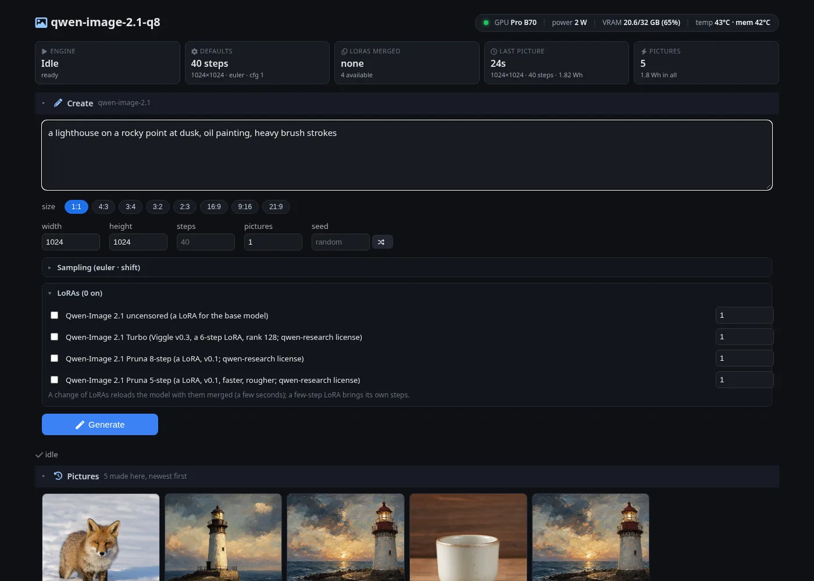
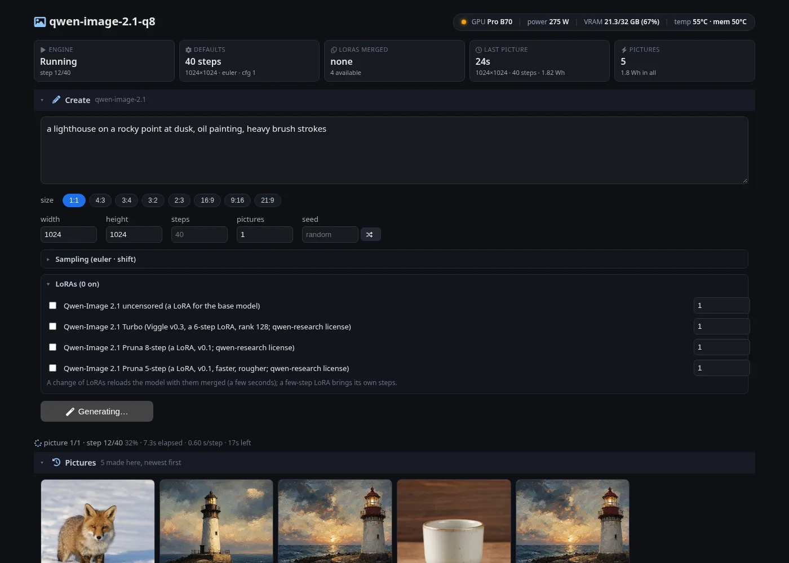
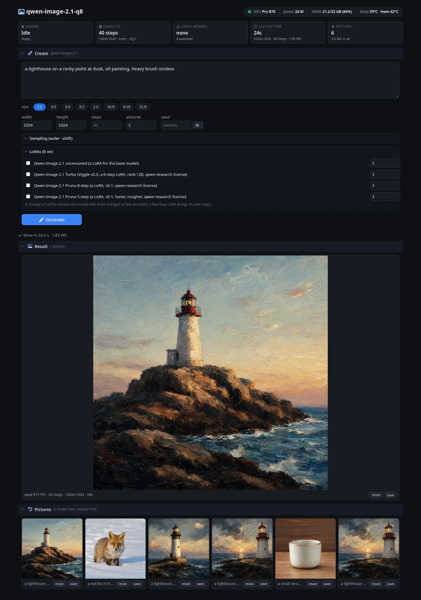
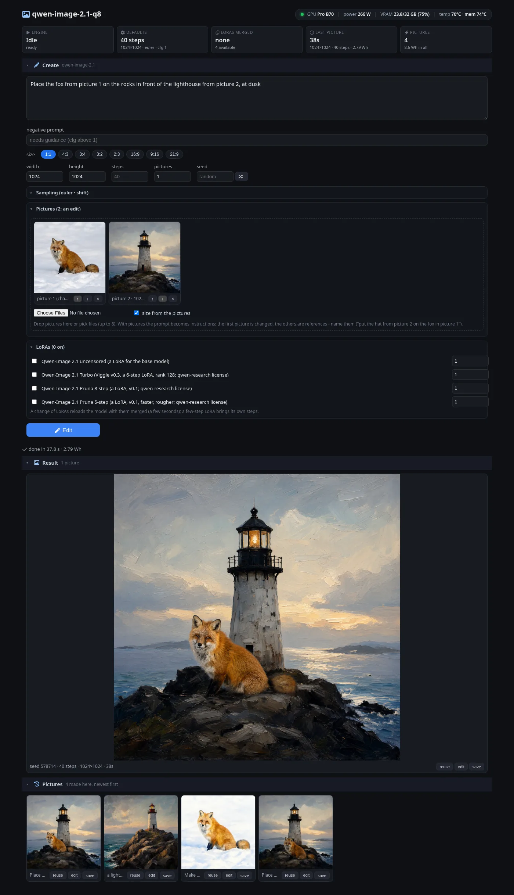
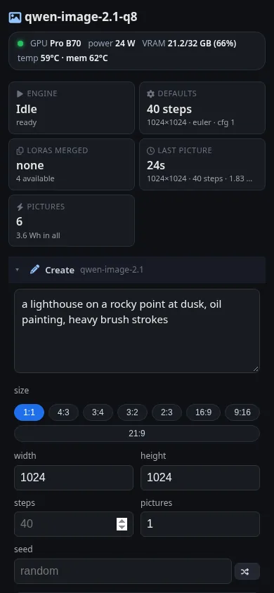

# Images

[← nextsycl](../README.md)

```sh
nextsycl models pull qwen-image-2.1-q8
nextsycl image gen "a red fox in fresh snow, morning light" [--model ID] [--size WxH | --aspect 16:9] [--steps N]
                   [--seed N] [--n N] [--sampler S] [--schedule S] [--shift X] [--cfg X --negative TEXT]
                   [--lora NAME[:SCALE]]... [--out FILE|DIR] [--rgba] [--gpu N]
nextsycl image edit "put a red knitted scarf on the fox" --image fox.png [--image ref.png]... [gen's options]
nextsycl image check <reference dump dir> [--stages te,dit,steps,vae | edit-pre,edit-te,edit-vae,edit-dit] [--gpu N]
```

**Edits and compositions.** Give the model pictures and the prompt becomes instructions: the first picture is the one
changed, the others are references the instructions name ("place the fox from picture 1 in front of the lighthouse
from picture 2"), up to 8. As Qwen-Image 2.1's pipeline does it: each picture resized (PIL's Lanczos, exactly) to
the output area at its aspect; seen by Qwen3-VL's vision tower (27 blocks, deepstack features into the first three
text layers) inside the prompt; encoded by the VAE's encoder, its latents put in the denoiser's sequence where the
prompt has the picture's slots (block-causal: text causal, each picture's block with itself and all before it). The
output takes the last picture's aspect unless a size is given. Checked against the pipeline's code at 512 and 1024
(`reference/qwenimage21/ref.py edit-*`): patches and positions exact, the vision tokens 2e-3, the VAE encoder 2e-3,
the denoiser 4e-4 over 12 steps, the picture within 6/255. An edit at 1024x1024 takes ~31 s on the B70 (40 steps;
the prefix of text and one 1024 picture is 4,119 tokens, computed once). Guidance: `--cfg` above 1 with
`--negative` (two passes a step; the pictures in both).

**Samplers and schedules.** ComfyUI's: 29 samplers (euler, euler_ancestral, heun, heunpp2, dpm_2, dpm_2_ancestral,
lms, dpmpp_2s_ancestral, dpmpp_sde, dpmpp_2m, dpmpp_2m_sde, dpmpp_2m_sde_heun, dpmpp_3m_sde, ddpm, lcm, ipndm,
ipndm_v, deis, res_multistep, res_multistep_ancestral, gradient_estimation, er_sde, seeds_2, seeds_3,
exp_heun_2_x0, exp_heun_2_x0_sde, ddim, uni_pc, uni_pc_bh2) and their schedulers (simple, sgm_uniform, karras,
exponential, ddim_uniform, beta, normal, linear_quadratic, kl_optimal) besides the model's own (`shift`), ported from
ComfyUI's code with its flow-model paths (`crates/diffusion` samplers.rs; `reference/samplers` runs ComfyUI's own
code: every sampler within 1.1e-6, every schedule within 8.3e-7). Euler on the model's schedule runs on the GPU
alone; the others step on the host (the latents, 1 MB at 1024x1024, cross each call). The ComfyUI schedules take the
model's own shift for the size unless `--shift` is given. Karras and exponential crowd the steps at the clean end,
which flow models handle badly - shift, simple, beta or normal suit them. The SDE samplers draw plain normals where
ComfyUI uses a Brownian tree: a seed gives another picture than ComfyUI's, equally valid.

`--lora` takes a registered LoRA (`nextsycl models pull qwen-image-2.1-uncensored-lora`) or a file; it is merged
into the DiT's matrices at load (PEFT, kohya and diffusers files; ~0.4 s, nothing a step), half or int8 alike, and
named in the PNG. Checked against the reference with the same LoRA merged in PyTorch: the latents after 20 steps
8.4e-4 off (without the LoRA, 3.3e-3).

Few-step models: `qwen-image-2.1-turbo-q8` (Viggle's v0.3 distill merged into the transformer: 6 steps) and the
LoRAs `qwen-image-2.1-turbo-lora`, `qwen-image-2.1-pruna-8step-lora`, `-5step-lora` each bring their own sigmas
(`NS_QI_SIGMAS`, `NS_QI_SIGMA_SHIFT` in their registry settings). All checked against the reference run with the
same files and schedules: turbo 6 steps 2.9e-3, Pruna 8 steps 2.2e-3, their images at most 2 / 4 of 255 off.
On the B70 a turbo picture takes 3.2 s: 1024x768 in half, 1024x1024 with `NS_QI_INT8=1` (6 steps, the prompt and the VAE included).

## P-H3-Image

```sh
nextsycl models pull p-h3-image                 # or -q8 (AtomicChat's Q8_0), -lora (MiniMax H3's FL2VA int8 + Pruna's LoRA)
nextsycl image gen 'A photograph by an experienced street photographer of ...' --model p-h3-image [--size 2912x2912]
nextsycl image edit 'Snow covers the street. Keep the figures exactly as they are.' --image PICTURE [--image REFERENCE]... --model p-h3-image
nextsycl image check <reference dump dir> --model p-h3-image [--stages te,venc,dit,steps,vae,silo]
```

Pruna AI's image model on MiniMax H3's denoiser (crates/h3, the video engine's): 8 steps on the checkpoint's own sigmas, no
guidance, sides multiples of 32, best at 8 MP (2912x2912 by default; the page's 1 / 4 / 8 MP presets give Pruna's sizes). An
edit takes up to 8 pictures (picture 1 edited, the others references named Picture 2 ...); without a size it is made at
picture 1's size within 4 to 8 MP. Prompts are rendered as written (Pruna's Qwen3.5-9B prompt upsampler is not run: write
full prompts, model-cards/guides/p-h3-image.md). Parity, speed and what is open: [ports/p-h3-image.md](ports/p-h3-image.md).

## MOSS-Image-SFT

```sh
nextsycl models pull moss-image-sft-q4kxl      # or -q8, -q6kxl, -q5kxl, -q4km, -bf16
nextsycl image gen 'A small red fox in fresh snow, a wooden sign reading "WELCOME"' --model moss-image-sft-q4kxl [--size 1024x1024]
nextsycl image check <reference dump dir> --model moss-image-sft-q4kxl [--stages sigmas,tokens,te,dit,steps,vae,full,bench]
nextsycl image serve moss-image-sft-q4kxl --wfe      # POST /v1/images/generations, the same page as the others
```

OpenMOSS's 5.1B text to image model (50 steps, CFG 3 with block 22 left out as the guidance branch; sizes multiples of 16;
the negative prompt, empty by default, is the guidance branch's prompt; the shift is a request's). Port notes, parity and speed: [ports/mossimage.md](ports/mossimage.md). B70, 1024x1024,
50 steps with CFG, through the server: 46.7 s (the card's 3.5 Wh); 512x512, 12 steps 3.4 s. Every quant loads and draws;
Q3_K files do not (no Q3_K in the dequant yet).

**Sizes.** Any multiples of 16 from 64 to 4096 a side; the page offers OpenMOSS's own presets (its Gradio app's
`gradio_presets.py`): 15 aspect ratios (1:8 to 8:1) and the budgets 512², 1M, 1.5M, 2M and 4M pixels, a size being the
budget's root at the ratio with each side rounded to 16 (`fit_size`: 16:9 at 1M 1360x768, 2:3 at 1.5M 1024x1536; a
side past 4096 is capped there). `/api/info` reports them as `sizes` (`ratios`, `pixels`).

**Turbo LoRAs.** Four few-step LoRAs for MOSS-Image (the Civitai page "Moss Image Turbo LoRAs", the weights lodestones'
and akhaliq's) run it without guidance in 4 or 8 steps:

```sh
nextsycl models pull moss-image-turbo-sft-4step-lora     # or -sft-8step-, -base-8step-, -dmd2-8step-lora (1.1 GiB each)
nextsycl image gen 'a neon sign on a rainy street that reads "WELCOME"' --model moss-image-sft-q4kxl --lora moss-image-turbo-sft-4step-lora
```

The LoRA is merged into the half matrices at load (W += B . A, rank 128, one rounding to half; every block must
be expanded, so `NS_MOSS_EXPAND=0` refuses a LoRA and the card must have room for them, 1.5 GiB kept free) and
brings its steps and guidance (`NS_MOSS_STEPS`, `NS_MOSS_CFG`: 4 or 8 steps, cfg 1). One LoRA at a time, strength 1.
B70, 1024x1024: 4 steps 2.9 s, 8 steps 4.5 s, the quoted "WELCOME" spelled right. A request's `loras` reload the model with them merged (as Qwen-Image's do), a side path is
not offered. The 8-step LoRAs also work at 4 steps (the DMD2 one best); the 4-step one wants 6 steps around 1536 wide
and 8 at 2048x2048.

## Z-Image-Turbo

```sh
nextsycl models pull z-image-turbo
nextsycl image gen 'A small red fox in fresh snow, a wooden sign reading "WELCOME"' --model z-image-turbo [--size 1280x720] [--steps 8] [--shift 3]
nextsycl image check <reference dump dir> --model z-image-turbo [--stages tokens,te,dit,steps,vae,full,bench,sizes]
```

Tongyi-MAI's 6B text to image model (Apache-2.0), distilled to 8 steps without guidance: Z-Image's single-stream DiT
(the transformer Ming-Image is built on) conditioned by Qwen3-4B's hidden states, Flux.1's VAE. The files are the
official weights to the bit (unsloth's BF16 GGUF of the DiT, ComfyUI's single-file Qwen3-4B), all on one card.
No negative prompt and no guidance (cfg 1, or the pipeline's 0; another is refused); sizes are multiples of 16 from
256 to 2048 a side, the page offering the model's own demo sizes (1024, 1280 and 1536 squared budgets, 1:1 to 21:9);
steps 1 to 50 (8: the model's), the shift a request's (3: the model's). A 1024 x 1024 picture, the whole request: B70
4.5 s, B65 6.8 s (2048 x 2048: 24.7 s / 38.1 s), 19.4 GiB on the card. `z-image-turbo-int8` (Comfy-Org's int8
ConvRot DiT, the card's int8 products) takes 3.3 s / 4.8 s and 13.8 GiB, the same compositions with small details
drawn differently. Port notes, parity and speed: [ports/z-image-turbo.md](ports/z-image-turbo.md).

## HunyuanImage 2.1

```sh
nextsycl models pull hunyuanimage-2.1-distilled-q8      # or hunyuanimage-2.1-q8 (the base model)
nextsycl image gen 'a shop window at night, a neon sign that reads "OPEN LATE"' --model hunyuanimage-2.1-distilled-q8 [--size 2048x2048]
nextsycl image check <reference dump dir> --model hunyuanimage-2.1-distilled-q8 [--stages te,byt5,dit,steps,vae]
```

Tencent's 17B DiT (20 double-stream + 40 single-stream blocks of 3584, 2-D RoPE on the image's tokens, a token
refiner over the text) from calcuis' GGUFs: the DiT Q8_0 (kept Q8_0 on the card, each matrix expanded to half just
before its product - shared by guidance's two passes), Qwen2.5-VL-7B Q4_0 for the prompt (hidden_states[-3] under the
official template, its 34 template tokens dropped), byT5-small (float32) for the text the prompt quotes, joined as
the official reorder_txt_token does ([glyph tokens | Qwen tokens]; padding dropped - the official attention masks it),
and the 32x VAE decoder (half, run whole: the official tiling is said to spoil the picture). The distilled model runs
8 steps with its guidance embedded and MeanFlow's next timestep; the base model 50 with a negative prompt (empty by
default, as the pipeline) under the pipeline's MIX_mode_0 - CFG for 5 steps, then adaptive projected guidance
(`--opt-guidance cfg`: plain CFG). Sizes are multiples of 32; 2048x2048 is native. Not yet: the refiner, LoRAs,
edits, the glyph tokenizer's color / font tags.

Checked against `reference/hunyuanimage21/ref.py` (the official modules, pinned commit, on the same GGUFs in float32
on the CPU; 512x512, a prompt quoting "HELLO"): text encoder rel 4.9e-4 (cosine 1.000000), byT5 2.6e-7, the token
refiner 5.9e-7, double block 0 1.2e-4, after the 20 double blocks 3.0e-3, the first velocity 1.5e-3 (base model with
CFG: 8.5e-4), the latents after 8 distilled steps 2.3e-3 (base, 4 CFG steps: 3.0e-3), the VAE's picture 7.3e-4.
B70 (2026-10-19; before the silo in brackets): distilled 2048x2048 7.8 s a picture (10.3), 1024x1024 2.5 s (3.9);
base 2048x2048 82.7 s (101.1), 1024x1024 20.2 s (31.8). The silo (kernels/image/hunyuanimage21/silo) reads the
DiT's Q8_0 matrices as int8 inside oneDNN's product (no half copy first), fuses GELU and the gated residual adds into
the products, runs guidance's two passes as one batch and the VAE's group norm on 8-half vectors; the checks hold
(distilled latents 2.5e-3, base 3.4e-3) and the pictures match main's to 55-59 dB PSNR (41 dB at distilled 2048).
`--opt-int8` (`NS_HI_INT8=1`) also multiplies in int8 x int8: distilled 2.0 s / 5.9 s, base 14.4 s / 59.2 s, approximate
(the same picture, other details: 24.7-39 dB against the exact one). 25.4 GiB on the card at 2048x2048.

`gen` runs the engine in-process (the server path, `image serve | start | ps`, comes next); the PNG keeps the
prompt, model, seed, size and steps. `check` compares each stage with the dumps of `reference/qwenimage21/ref.py`.

## Pictures to prompts (`image.describe`)

```sh
nextsycl image describe barn.png --target z-image-turbo [--detail short|medium|long] [--negative] [--json] [--server HOST:PORT]
```

The prompt that would draw a picture, written the way the target image model reads prompts (families: natural,
qwen-image, z-image, h3, hunyuanimage, moss-image, ming-image, tags), with a negative prompt for the models that read
one and a canvas at the picture's aspect for the target. The describer is a chat model that reads pictures
(`qwen3.8-27b-q4-describe`: Qwen3.8-27B and its vision tower, a short context); the front door's `image.describe` runs it
as a job in the image queue (label, cancel), the home page's Describe tab calls it, and so does the image page's
Describe panel (below). The contract, the measured speeds and
a round trip (describe, draw the prompt again, compare) are in [docs/api/image-describe.md](api/image-describe.md).

### The image page's Describe panel

The image page (`wfe/image`) has a **Describe** panel (closed until opened; "describe" on a picture in its history opens it
with that picture): drop, pick or paste (Ctrl+V) a picture, choose what the prompt is for (the model the page serves,
by default, or a family: natural, qwen-image, z-image, h3, hunyuanimage, moss-image, ming-image, tags) and who reads it
(`best`, `native`, or a describer from `image.describers`), the length (or the words), the language, an optional
negative prompt (offered where the target's models read one) and more instructions for the describer. **Describe** runs
`image.describe` as a job - the first one after a while loads the describer (about 45 s cold, said on the panel) - with
a **cancel** (by the job's label: `page-describe-<ms>`). The prompt arrives in an editable box with **copy** and **Use as
prompt**, which fills the page's prompt (and negative, when this model takes one) and sets width and height to the
`suggested_size` when the description is for this page's model or family and the sides fit the page's grid. Errors are
shown as the server words them (409: no model of the family or no describer enabled; the refusal shapes in
[image-describe.md](api/image-describe.md)).

The page's own server has no token and no chat model, so the panel talks to the front door through
`/open/<model>/api/describe` (`GET`: `image.describers`; `POST`: `image.describe` as a job, only the panel's fields;
`GET .../status?label=`: `image.status`; `POST .../cancel {label}`: `image.cancel`, only for a `page-describe-` label so
the page cannot stop anyone else's work). A server run alone (`nextsycl image serve --wfe`, port 8086) has no such
route: the panel says so and points at the front door and `nextsycl image describe`.

## The image server and its web front end

```sh
nextsycl image serve qwen-image-2.1-q8 [--wfe] [--port 8086] [--host 0.0.0.0] [--gpu N] [--lora NAME[:SCALE]]...
                     [--set NAME=VALUE]... [--out DIR] [--cors ORIGIN]
nextsycl image start ...      # the same in the background (ready when it answers); image ps | logs [-f] | stop
                              # --idle-exit SECONDS: the server ends after that long without work
```

From the host it runs the build image as container `nextsycl-image` (the GPU, `dist/`, the registry, the model's and
its LoRAs' files read-only, the output directory - default `~/.local/share/nextsycl/images` - writable) and serves:

- `POST /v1/images/generations` - OpenAI's images API: `prompt`, `n`, `size`, `response_format` (`b64_json` or `url`),
  `background: "transparent"` (RGBA); and ours: `steps`, `seed`, `sampler`, `schedule`, `shift`, `cfg`,
  `negative_prompt`, `loras` (`["name:scale"]` or `[{name, scale}]` - another set reloads the model with them
  merged, ~4 s; a few-step LoRA brings its own sigmas and steps). The answer's `nextsycl` field has the seconds, steps,
  seed, LoRAs and the card's energy (Wh). Every picture is saved with its settings in the PNG.
- `POST /v1/images/remove-background` (a remover: `birefnet`, `isnet-general-use`; the front door's
  `image.remove_background`) - `image`, `mask`, `post_process_mask`, `response_format`: the RGBA picture at its size
  (its own colours, the mask as straight alpha) and with `mask` the 8-bit grey mask, as `b64_json` / `mask_b64_json`
  or `url` / `mask_url`; `nextsycl.seconds`. docs/ports/remove-background.md has the checks against rembg.
- `GET /v1/models`, `/health`, `/v1/images/files/<f>`, `/api/info` (the model, its defaults, samplers, schedules,
  LoRAs, and what the engine takes: `guidance` (cfg and a negative prompt), `grid` (the sides' multiple: 16, HunyuanImage's
  32), `sizes` (the ratios and pixel budgets a page offers: MOSS-Image's), `transparent` (an alpha channel: Qwen-Image, Ming, HunyuanImage; not MOSS-Image's), `shift`: the page snaps its
  size fields to the grid and shows only the controls the engine takes), `/api/progress`, `/api/history`, `/api/gpu`.
- `--wfe`: the web front end at `/` (`wfe/image`, built into `dist/wfe` by `./build.sh wfe`): H3's scheme - TSX on
  vendored snabbdom, compiled offline by the vendored TypeScript, one state object, panels, H3's stylesheet - with
  every option of a request, live progress (step, s/step, time left), the card's power, VRAM and temperatures, and
  the pictures made (an earlier session's too, read back from the PNGs). `node wfe/check.mjs` smoke-tests a running
  one (every module parses, the page renders headlessly).

Screenshots for a quick look when debugging the page (`docs/screenshots/shoot.py image http://localhost:8086
docs/screenshots` retakes them):

| Idle | Running | Done |
|---|---|---|
|  |  |  |

An edit - two pictures composed by the instructions (the page's Pictures section; "edit" on any picture made here
adds it):



The API: `POST /v1/images/edits` takes OpenAI's multipart form (`image` / `image[]` files, `prompt` and the other
fields) or JSON with `images` (base64 or data URLs):

```sh
curl localhost:8086/v1/images/edits -F "image[]=@fox.png" -F "image[]=@lighthouse.png" \
     -F "prompt=Place the fox from picture 1 in front of the lighthouse from picture 2" -F response_format=url
```



The stock model (`qwen-image-2.1-q8`, 40 steps, Euler, one picture) on each card alone, through the server
(`nextsycl image serve` timed by a client of its API, 2026-10-09). Each cell:
the request's time end to end (prompt, 40 steps, VAE, PNG) · one step of the DiT (from a 40-step and a 1-step run,
after a warm-up at that size) · the card's energy for the picture (its sensor). Load: start to the first `/health`
answer, files in the page cache.

| card, weights | load | 512×512 | 768×768 | 1024×768 | 1024×1024 | 1536×1536 |
|---|---|---|---|---|---|---|
| B70, half | 6.5 s | 5.4 s · 0.13 s/step · 0.41 Wh | 13.0 s · 0.32 s/step · 1.00 Wh | 17.4 s · 0.43 s/step · 1.33 Wh | 23.8 s · 0.59 s/step · 1.81 Wh | 62.1 s · 1.54 s/step · 4.74 Wh |
| B70, int8 (`--opt-int8`) | 7.5 s | 3.6 s · 0.09 s/step · 0.27 Wh | 8.8 s · 0.22 s/step · 0.67 Wh | 11.8 s · 0.29 s/step · 0.90 Wh | 16.5 s · 0.41 s/step · 1.26 Wh | 45.3 s · 1.12 s/step · 3.46 Wh |
| B65, half | 7.0 s | 8.5 s · 0.21 s/step · 0.47 Wh | 19.9 s · 0.49 s/step · 1.10 Wh | 27.1 s · 0.67 s/step · 1.50 Wh | 37.5 s · 0.93 s/step · 2.08 Wh | 98.4 s · 2.44 s/step · 5.46 Wh |
| B65, int8 (`--opt-int8`) | 7.5 s | 5.6 s · 0.14 s/step · 0.30 Wh | 13.2 s · 0.32 s/step · 0.72 Wh | 17.9 s · 0.44 s/step · 0.99 Wh | 25.0 s · 0.61 s/step · 1.38 Wh | 69.1 s · 1.70 s/step · 3.83 Wh |

Outside the steps a picture costs 0.1-0.5 s on the B70 and 0.2-1.0 s on the B65 (the prompt, the VAE, the PNG). The
B65 takes ~1.6x the B70's time in half and ~1.5x in int8; int8 is 1.4-1.5x faster than half on either card. The few-step
turbo model (`qwen-image-2.1-turbo-q8`, 6 steps) makes 1024×1024 in 3.2 s on the B70.

`NS_QI_INT8=1` (opt-in, in the environment or a registry entry's settings) keeps the DiT's block matrices as int8
ConvRot - each Q8_0 matrix rotated by the 256 x 256 Hadamard matrix along its inputs and quantized per row at load,
the activations quantized per row on the fly - on the card's int8 rate, twice its half one, in half the VRAM (~7 GB).
Its cost against the reference: velocity 5.8e-3 (half 3e-4), the latents after 20 steps 1.8e-2 (cosine 0.9998); the
1024x1024 fox against half's: PSNR 39.2 dB, mean pixel difference 0.57.

Where a 1024x1024 step goes on the B70 (`NS_QI_PROFILE=1`), int8: the block matrices ~50%, attention ~16% (ARK's
flash kernel on sycl-tla, `libnextsycl-flash.so`: 2.5 ms a block at 4k tokens, ~110 TFLOPS - oneDNN's fused SDPA
took 5.0; `NSD_FLASH=0` goes back to it), norms, gates, SwiGLU and RoPE ~16%. The VAE adds 0.7 s a picture (0.45 s of it its 3x3 convolutions).
